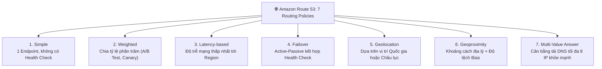
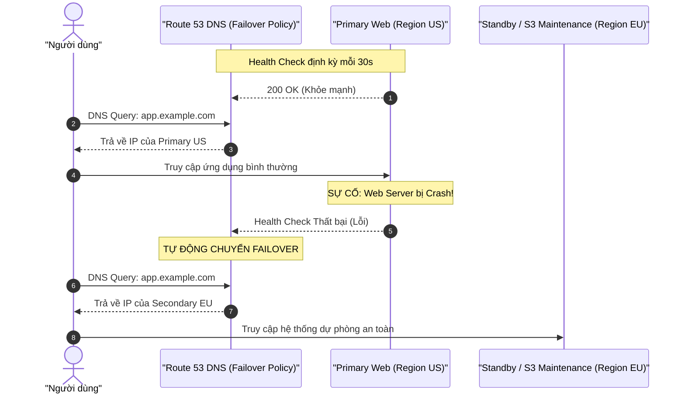

# 🌐 Route 53 Routing Policies & Failover: Cấu Hình DNS Khả Dụng Cao

> Thuộc: [[Task-2.2-Highly-Available-and-Fault-Tolerant]] | So sánh nhanh: [[Matrix-Route-53-Routing-Policies]] | Trở về: [[00-Domain-2-MOC]]

---

## 1. Khái niệm cốt lõi (Core Concepts)

**Amazon Route 53** là dịch vụ hệ thống tên miền (DNS) có tính sẵn sàng cực cao (**100% Availability SLA**) và khả năng mở rộng quy mô toàn cầu. Ngoài việc phân giải tên miền thành địa chỉ IP, Route 53 đóng vai trò là "người gác cổng" điều phối lưu lượng mạng toàn cầu cho các kiến trúc đa vùng (**Multi-Region**) và khôi phục thảm họa (**Disaster Recovery**).

---

## 2. Alias Records vs CNAME Records: Sự khác biệt kinh điển

Đây là một trong những câu hỏi kiểm tra phân biệt xuất hiện liên tục trong bài thi SAA-C03:

| Tiêu chí | CNAME Record (Chuẩn DNS chung) | Route 53 Alias Record (Đặc quyền AWS) |
| :--- | :--- | :--- |
| **Trỏ tên miền gốc (Zone Apex / Root Domain)** | **KHÔNG THỂ** (Không thể tạo CNAME cho `example.com`) | **CÓ THỂ** (Trỏ trực tiếp `example.com` tới tài nguyên AWS) |
| **Đối tượng trỏ tới** | Bắt buộc trỏ tới một **Domain Name khác** (ví dụ: `app.otherdomain.com`) | Trỏ tới các **tài nguyên AWS nội bộ** (ALB, CloudFront, S3 Website, API Gateway) |
| **Chi phí truy vấn DNS** | Tính phí theo số lượng request DNS | **HOÀN TOÀN MIỄN PHÍ** khi trỏ tới tài nguyên AWS |
| **Khả năng tự động đổi IP** | Client phải giải mã 2 lần (chậm hơn) | Route 53 tự động nhận diện thay đổi IP của AWS resource |
| **Tích hợp Health Check** | Không trực tiếp | **Có hỗ trợ đánh giá tình trạng sức khỏe mục tiêu** |

> **Nguyên tắc thi cử:** Nếu câu hỏi yêu cầu *"Trỏ tên miền gốc của công ty (`mycompany.com`) tới một Application Load Balancer"* $\rightarrow$ **Bắt buộc chọn Alias Record (A Record)**, loại bỏ ngay CNAME!

---

## 3. Bảy Chính sách Định tuyến (7 Routing Policies) của Route 53

### 1. Simple Routing Policy
- Cấu hình DNS cơ bản nhất: Trỏ 1 bản ghi tới 1 địa chỉ IP duy nhất (hoặc 1 danh sách nhiều IP trả về ngẫu nhiên cho client).
- **Lưu ý:** Không hỗ trợ cơ chế Health Check.

### 2. Weighted Routing Policy (Theo tỷ lệ phần trăm)
- Gán cho mỗi endpoint một trọng số (Weight) từ 0 đến 255. Tỷ lệ traffic gửi đến mỗi endpoint = $\frac{\text{Weight}}{\text{Tổng Weight}}$.
- **Ứng dụng đề thi:** Thử nghiệm phiên bản phần mềm mới (Canary Deployment, A/B Testing) — ví dụ: Gửi 90% traffic tới phiên bản cũ v1 và 10% traffic tới phiên bản mới v2.

### 3. Latency-Based Routing Policy (Theo độ trễ mạng)
- Route 53 liên tục đo độ trễ mạng giữa người dùng trên thế giới và các AWS Regions. Khi người dùng truy vấn, nó sẽ tự động điều hướng tới **Region đem lại độ trễ mạng thấp nhất (Lowest Latency)** cho người dùng đó.

### 4. Failover Routing Policy (Khắc phục sự cố Active-Passive)
- Gồm 2 bản ghi: **Primary** (chính) và **Secondary** (dự phòng).
- Route 53 gắn **Health Check** vào bản ghi Primary. Nếu Primary khỏe mạnh, 100% traffic đi vào Primary. Nếu Primary gặp sự cố (Fail health check), Route 53 sẽ **tự động chuyển hướng toàn bộ traffic sang Secondary** (ví dụ: Region dự phòng hoặc trang thông báo bảo trì tĩnh lưu trên S3).

### 5. Geolocation Routing Policy (Theo vị trí địa lý)
- Điều hướng dựa trên **vị trí địa lý thực tế của người dùng** (theo Châu lục, Quốc gia, hoặc Bang của Mỹ).
- **Ứng dụng:** Điều hướng người dùng ở Châu Âu tới trang web tiếng Pháp/Đức và tuân thủ luật GDPR; người dùng ở Mỹ tới trang web tiếng Anh.

### 6. Geoproximity Routing Policy (Theo khoảng cách địa lý + Tham số BIAS)
- Điều hướng dựa trên khoảng cách địa lý từ người dùng tới tài nguyên AWS kết hợp với tham số **Bias (Độ lệch: từ -99 đến +99)**.
- Tăng Bias sẽ mở rộng vùng phủ sóng địa lý của Region đó; giảm Bias sẽ thu hẹp vùng phủ sóng.
- **Yêu cầu bắt buộc:** Phải sử dụng công cụ **Route 53 Traffic Flow**.

### 7. Multi-Value Answer Routing Policy (Cân bằng tải DNS)
- Tương tự Simple Routing nhưng **hỗ trợ Health Checks**.
- Trả về tối đa **8 bản ghi IP khỏe mạnh** ngẫu nhiên cho client. Nếu 1 IP bị chết, Route 53 sẽ loại IP đó ra khỏi danh sách trả về.

---

## ⚠️ Bẫy đề thi & Mẹo ghi nhớ (Exam Traps)

| Tình huống đề thi | Đáp án bẫy (SAI) | Đáp án chuẩn (ĐÚNG) |
| :--- | :--- | :--- |
| Cần trỏ tên miền apex (`example.com`) tới Application Load Balancer | Tạo CNAME record | Tạo **Route 53 Alias A-Record** trỏ tới ALB |
| Tự động chuyển hướng người dùng sang Region thứ hai khi Region chính bị sập | Dùng Latency Routing hoặc Simple Routing | Sử dụng **Failover Routing Policy** kết hợp với **Route 53 Health Checks** |
| Thử nghiệm phiên bản website mới cho 5% người dùng ngẫu nhiên | Dùng Geolocation Routing | Sử dụng **Weighted Routing Policy** (trọng số 95 và 5) |
| Phục vụ nội dung theo ngôn ngữ địa phương và tuân thủ quy định pháp lý quốc gia | Dùng Latency Routing | Sử dụng **Geolocation Routing Policy** |

---

## 🔗 Liên kết liên quan
- [[Task-2.2-Highly-Available-and-Fault-Tolerant]]
- [[Matrix-Route-53-Routing-Policies]]
- [[Disaster-Recovery-Strategies-RTO-RPO]]
- [[Elastic-Load-Balancing-Deep-Dive]]
