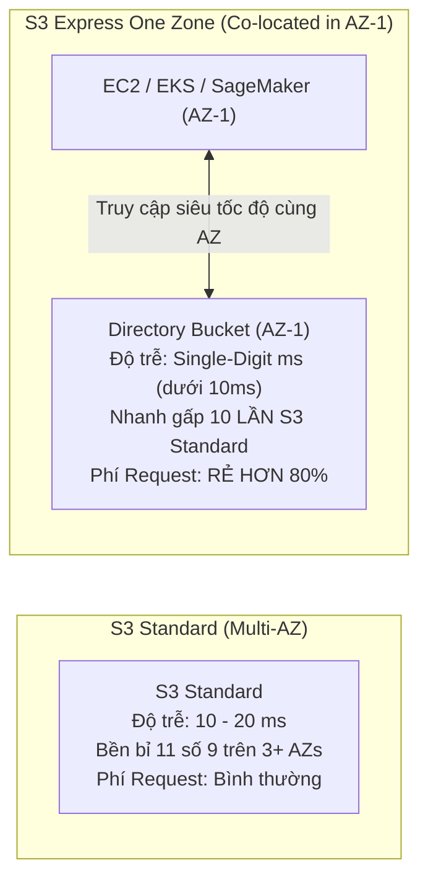
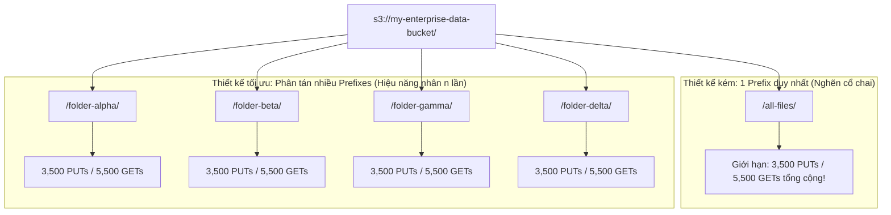

# 🚀 S3 Express One Zone & S3 Storage Performance Optimization

> Thuộc: [[Task-3.1-High-Performing-Storage]] | So sánh nhanh: [[Matrix-S3-Performance-Options]] | Trở về: [[00-Domain-3-MOC]]

---

## 1. Amazon S3 Express One Zone: Đột Phá Hiệu Năng 2026

**Amazon S3 Express One Zone** là lớp lưu trữ đối tượng hiệu năng cao nhất từng được AWS giới thiệu, được thiết kế chuyên biệt cho các khối lượng công việc đòi hỏi độ trễ cực thấp và tần suất truy xuất dữ liệu cực cao.

### So sánh các thông số cốt lõi:

| Tiêu chí kỹ thuật | Amazon S3 Standard | Amazon S3 Express One Zone |
| :--- | :--- | :--- |
| **Độ trễ truy xuất dữ liệu** | Hai chữ số mili-giây (~10 - 20 ms) | **Dưới 10 mili-giây (Single-digit ms)** |
| **Tốc độ so với Standard**| Chuẩn cơ sở | **Nhanh gấp tới 10 LẦN** |
| **Chi phí gọi Request** | Mức chuẩn | **RẺ HƠN TỚI 80%** |
| **Loại Bucket** | General Purpose Buckets | **Directory Buckets** |
| **Phạm vi khả dụng** | Đa vùng (**Multi-AZ** trên toàn Region) | **Đơn vùng (Co-located trong 1 AZ cụ thể)** |
| **Khối lượng công việc tối ưu**| Web assets, Data lake lưu trữ dài hạn, sao lưu | **Machine Learning training, AI inference, Xử lý tài chính tần suất cao (HFT), Media Transcoding** |

> **Bí quyết thi cử 2026:** Nếu đề bài nhắc đến bài toán huấn luyện Machine Learning hoặc mô phỏng tài chính yêu cầu hàng triệu thao tác đọc/ghi mỗi giây với **độ trễ dưới 10 mili-giây** và **tiết kiệm chi phí request** $\rightarrow$ **Đáp án luôn là Amazon S3 Express One Zone**.

---

## 2. Tối Ưu Hóa Hiệu Năng Với S3 Prefixes (Prefix Scaling)

Trong Amazon S3 Standard, hiệu năng request được phân bổ độc lập theo từng **Prefix** (tiền tố đường dẫn thư mục):
- **Giới hạn hiệu năng trên MỖI PREFIX:**
  - **3,500 PUT / COPY / POST / DELETE** requests mỗi giây.
  - **5,500 GET / HEAD** requests mỗi giây.

> **Cách tính tổng thông lượng:** Nếu bạn chia dữ liệu đồng đều vào 10 Prefixes khác nhau, tổng khả năng phục vụ của bucket sẽ tăng lên thành **35,000 PUTs/s** và **55,000 GETs/s**!

---

## 3. Các Kỹ Thuật Tăng Tốc Truyền Tải S3 Cốt Lõi

### A. Multipart Upload (Tải lên nhiều phần song song)
- **Quy tắc bắt buộc:** Với các file có kích thước **lớn hơn 5 GB**, Multipart Upload là **BẮT BUỘC**.
- **Khuyến nghị hiệu năng:** Với file từ **100 MB trở lên**, bạn nên bật Multipart Upload.
- **Cơ chế hoạt động:** File được chia thành các phần nhỏ (Parts) từ 5 MB đến 5 GB và upload song song đa luồng. Nếu một phần bị lỗi mạng giữa chừng, hệ thống chỉ cần upload lại đúng phần đó thay vì phải tải lại cả file từ đầu.

### B. S3 Byte-Range Fetches (Tải về từng đoạn song song)
- Cho phép client gửi HTTP GET request kèm header `Range: bytes=0-1048575` để chỉ tải về các đoạn dữ liệu cụ thể.
- **Ứng dụng hiệu năng:**
  1. Tải về file khổng lồ nhanh hơn bằng cách mở nhiều luồng tải song song các đoạn byte khác nhau rồi ghép lại.
  2. Phục vụ tính năng xem trước (Preview) hoặc xem video trực tuyến: người dùng có thể tua nhanh tới phút thứ 30 mà trình duyệt chỉ cần tải đúng đoạn video đó mà không cần tải toàn bộ file.

### C. S3 Transfer Acceleration (Tăng tốc chuyển dữ liệu xuyên biên giới)
- Sử dụng mạng lưới hơn 400+ **Edge Locations của Amazon CloudFront**.
- Dữ liệu từ client được đẩy vào Edge Location gần nhất qua Internet công cộng, sau đó được vận chuyển về S3 bucket qua mạng trục cáp quang riêng tối ưu của AWS $\rightarrow$ tăng tốc độ upload xuyên lục địa từ **50% đến 500%**.

### D. S3 Select (Lọc dữ liệu trực tiếp tại Storage)
- Cho phép ứng dụng sử dụng câu lệnh SQL đơn giản (`SELECT * FROM s3object s WHERE s.status = 'ACTIVE'`) để lọc nội dung các file CSV, JSON hoặc Apache Parquet ngay trên S3.
- Thay vì phải tải toàn bộ file 50 GB về máy chủ rồi mới lọc, S3 Select chỉ truyền tải về máy chủ **đúng 5 MB dữ liệu đã lọc**, giúp **giảm tới 80% chi phí truyền tải dữ liệu và tăng tốc độ xử lý của ứng dụng lên gấp 4 lần**.

---

## ⚠️ Bẫy đề thi & Mẹo ghi nhớ (Exam Traps)

| Tình huống đề thi | Đáp án bẫy (SAI) | Đáp án chuẩn (ĐÚNG) |
| :--- | :--- | :--- |
| Huấn luyện mô hình Deep Learning trên EC2 cần đọc hàng nghìn file ảnh từ S3 với độ trễ thấp nhất trong 1 AZ | Chọn S3 One Zone-IA (One Zone-IA có phí request rất đắt và độ trễ cao) | Sử dụng **Amazon S3 Express One Zone (Directory Buckets)** |
| Ứng dụng đọc file nén CSV dung lượng 10 GB từ S3 nhưng chỉ cần lấy 100 dòng dữ liệu cụ thể | Tải toàn bộ file 10 GB về EC2 rồi dùng Python lọc | Sử dụng **S3 Select** để thực thi câu lệnh SQL lọc dữ liệu trực tiếp tại S3 |
| Khách hàng toàn cầu phàn nàn việc tải các file đồ họa 500 MB lên S3 bucket tại us-east-1 quá chậm | Tăng băng thông mạng của S3 bucket | Bật tính năng **S3 Transfer Acceleration** kết hợp **Multipart Upload** |
| Ứng dụng ghi log gặp lỗi `503 Slow Down` khi ghi hàng chục nghìn file/giây vào 1 thư mục S3 | Tăng kích thước máy chủ ghi log | Thiết kế lại cấu trúc đường dẫn phân tán file vào **nhiều Prefixes khác nhau** |

---

## 🔗 Liên kết liên quan
- [[Task-3.1-High-Performing-Storage]]
- [[Matrix-S3-Performance-Options]]
- [[EBS-Volume-Types-gp3-and-io2-Block-Express]]
- [[Domain-3-Scenario-Walkthroughs]]
