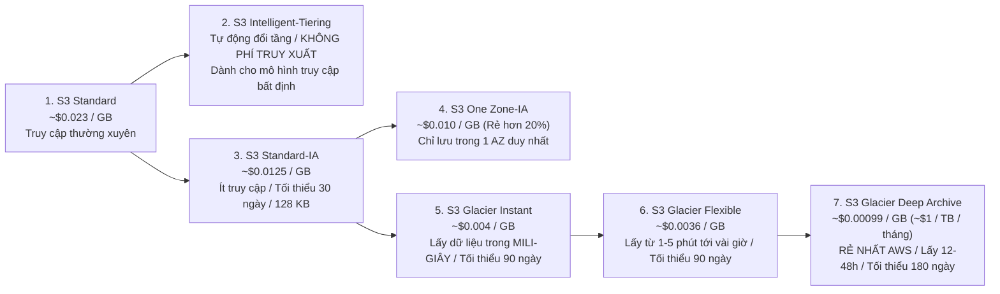
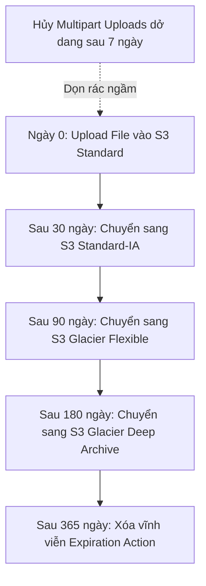

# 📦 S3 Lifecycle & Storage Classes Cost Tuning: 8 Lớp Lưu Trữ & Bẫy Chi Phí Ngầm

> Thuộc: [[Task-4.1-Cost-Optimized-Storage]] | So sánh nhanh: [[Matrix-S3-Storage-Classes-Cost-and-Retrieval]] | Trở về: [[00-Domain-4-MOC]]

---

## 1. Khái niệm cốt lõi (Core Concepts)

Chi phí lưu trữ đối tượng trên **Amazon S3** chiếm một phần đáng kể trong tổng chi phí đám mây của doanh nghiệp. Để tối ưu hóa chi phí đến mức tối đa, kiến trúc sư phải nắm vững:
1. **Đặc tính kinh tế của 8 lớp lưu trữ (Storage Classes).**
2. **Các điều kiện ràng buộc ngầm về cước phí:** Cước thời gian lưu trữ tối thiểu (Minimum Storage Duration) và Cước kích thước tệp tối thiểu (Minimum Object Size).
3. **Chính sách vòng đời tự động (S3 Lifecycle Rules).**

---

## 2. Bảng So Sánh Chi Phí & Đặc Tính 8 Lớp Lưu Trữ S3

| Lớp lưu trữ S3 | Cước lưu trữ / GB | Thời gian lấy dữ liệu | Phí truy xuất dữ liệu? | Số ngày lưu tối thiểu | Cỡ file tối thiểu tính tiền |
| :--- | :--- | :--- | :---: | :---: | :---: |
| **S3 Standard** | ~$0.023 | Tức thì (ms) | **KHÔNG** | Không giới hạn | Không giới hạn |
| **S3 Intelligent-Tiering**| Theo tầng thực tế | Tức thì (ms) | **KHÔNG** | Không giới hạn | 128 KB (Dưới 128KB ở tầng Frequent) |
| **S3 Standard-IA** | ~$0.0125 | Tức thì (ms) | **CÓ** ($0.01/GB) | **30 ngày** | **128 KB** |
| **S3 One Zone-IA** | ~$0.0100 | Tức thì (ms) | **CÓ** ($0.01/GB) | **30 ngày** | **128 KB** |
| **S3 Glacier Instant** | ~$0.0040 | Tức thì (ms) | **CÓ** ($0.03/GB) | **90 ngày** | **128 KB** |
| **S3 Glacier Flexible**| ~$0.0036 | 1-5 phút (Expedited) 3-5 giờ (Standard) | **CÓ** ($0.03-0.05/GB) | **90 ngày** | **40 KB** |
| **S3 Glacier Deep Archive**| **~$0.00099 (~$1/TB)**| **12 đến 48 giờ** | **CÓ** ($0.02/GB) | **180 ngày** | **40 KB** |
| **S3 Express One Zone**| ~$0.16 (Đắt hơn) | **Dưới 10ms (10x faster)**| Request rẻ hơn 80% | Không giới hạn | Không giới hạn |

---

## 3. Ba Bẫy Chi Phí Ngầm Trong Đề Thi SAA-C03

### Bẫy 1: Cước phí lưu trữ tối thiểu (Minimum Storage Duration)
- **Kịch bản:** Bạn tải một file lên **S3 Glacier Deep Archive**, sau 10 ngày bạn quyết định xóa file đó.
- **Cách AWS tính tiền:** S3 Glacier Deep Archive có quy định thời gian lưu tối thiểu là **180 ngày**. Mặc dù bạn chỉ lưu 10 ngày, AWS **vẫn sẽ tính tiền lưu trữ đủ 180 ngày** cho file đó (gọi là cước xóa sớm - Early deletion fee)!
- **Quy tắc:** Chỉ chuyển sang Glacier khi dữ liệu chắc chắn sẽ lưu lâu hơn 90 ngày (với Instant/Flexible) hoặc 180 ngày (với Deep Archive).

### Bẫy 2: Cước kích thước tệp tối thiểu (Minimum 128 KB Billing)
- **Kịch bản:** Bạn có 1 triệu file văn bản nhỏ, mỗi file chỉ nặng **5 KB**. Bạn chuyển toàn bộ sang **S3 Standard-IA** để tiết kiệm tiền.
- **Thực tế:** S3 Standard-IA quy định kích thước tính tiền tối thiểu là **128 KB**. Một file 5 KB sẽ bị tính cước phí tương đương một file 128 KB (bị đội dung lượng tính tiền lên gấp 25 lần!). Cộng thêm phí gọi request PUT/GET $\rightarrow$ **Hóa đơn của bạn sẽ đắt hơn gấp nhiều lần so với để ở S3 Standard**!
- **Giải pháp:** Đối với các file nhỏ dưới 128 KB, giữ nguyên ở **S3 Standard** hoặc nén thành các file zip lớn trước khi upload.

### Bẫy 3: Phí truy xuất dữ liệu (Data Retrieval Charges)
- Các lớp lưu trữ dạng IA (Infrequent Access) và Glacier có giá lưu GB rất rẻ, nhưng **thu phí mỗi khi bạn đọc (GET) dữ liệu**. Nếu một ứng dụng thường xuyên đọc lại các file trong Standard-IA, tiền phí truy xuất sẽ vượt xa số tiền lưu trữ tiết kiệm được.

---

## 4. S3 Intelligent-Tiering: Lựa Chọn Cứu Cánh Khi Không Rõ Xu Hướng

Khi đề bài thi mô tả: *"Dữ liệu có mô hình truy cập không thể dự đoán trước được (Unpredictable access patterns) hoặc thay đổi thất thường theo thời gian"*:
- **ĐÁP ÁN ĐÚNG LUÔN LÀ: S3 Intelligent-Tiering**.
- **Cơ chế hoạt động:**
  - Tự động di chuyển các object giữa 3 tầng truy cập tức thì (Frequent Access $\rightarrow$ Infrequent Access sau 30 ngày $\rightarrow$ Archive Instant Access sau 90 ngày) và 2 tầng lưu trữ sâu tùy chọn (Archive Access sau 90-730 ngày và Deep Archive sau 180-730 ngày).
  - **KHÔNG THU PHÍ TRUY XUẤT (NO RETRIEVAL FEES)**. Nếu một object cũ đột ngột được truy cập lại, nó tự động chuyển về tầng Frequent Access ngay lập tức mà không phát sinh bất kỳ khoản phí phạt nào!

---

## 5. Tự Động Hóa Vòng Đời Dữ Liệu: S3 Lifecycle Rules

- **Tự động hủy Multipart dở dang (Abort Incomplete Multipart Uploads):** Khi một tiến trình upload file lớn bị đứt mạng giữa chừng, các phần (parts) đã tải lên sẽ âm thầm nằm trong S3 và tiếp tục bị tính phí lưu trữ hàng tháng. Thiết lập một Lifecycle rule tự động hủy các mảnh dở dang sau 7 ngày sẽ dọn dẹp sạch sẽ các chi phí rác này.

---

## ⚠️ Bẫy đề thi & Mẹo ghi nhớ (Exam Traps)

| Tình huống đề thi | Đáp án bẫy (SAI) | Đáp án chuẩn (ĐÚNG) |
| :--- | :--- | :--- |
| Dữ liệu có tần suất truy cập không đoán trước được, muốn tối ưu chi phí mà không phát sinh phí truy xuất | Chuyển sang S3 Standard-IA | Sử dụng **Amazon S3 Intelligent-Tiering** |
| Lưu trữ hồ sơ y tế trong 10 năm, hiếm khi đọc lại nhưng khi cần BẮT BUỘC phải lấy lại được trong VÀI MILI-GIÂY | Chuyển sang S3 Glacier Flexible (Glacier Flexible mất từ vài phút đến vài giờ) | Sử dụng **Amazon S3 Glacier Instant Retrieval** |
| Sao lưu dữ liệu tuân thủ quy định pháp lý 7 năm với chi phí THẤP NHẤT TOÀN BỘ AWS, chấp nhận lấy dữ liệu trong 24 giờ | Chọn S3 Glacier Flexible | Sử dụng **Amazon S3 Glacier Deep Archive** (~$1/TB/tháng) |
| Muốn người khác tải dữ liệu từ S3 bucket của mình nhưng BẮT HỌ PHẢI TRẢ TIỀN download | Cấu hình IAM policy phức tạp | Bật tính năng **Requester Pays** trên S3 Bucket |

---

## 🔗 Liên kết liên quan
- [[Task-4.1-Cost-Optimized-Storage]]
- [[Matrix-S3-Storage-Classes-Cost-and-Retrieval]]
- [[EFS-and-EBS-Storage-Cost-Optimization]]
- [[Domain-4-Scenario-Walkthroughs]]
