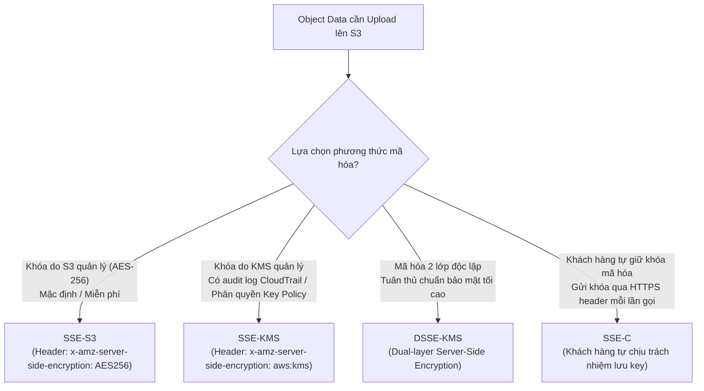
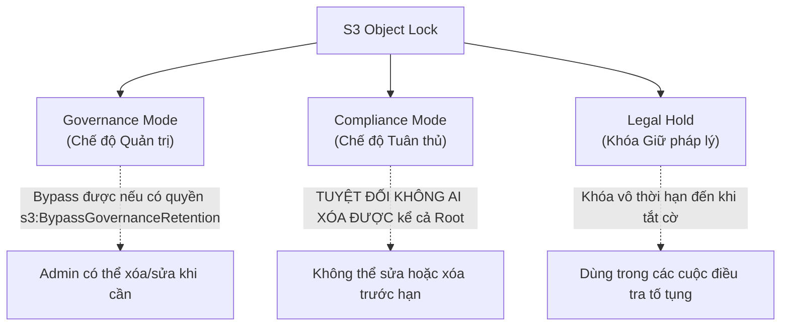

# 🪣 Amazon S3 Security & Compliance: Mã hóa, Object Lock (WORM) & Macie

> Thuộc: [[Task-1.3-Determine-Data-Security-Controls]] | Trở về: [[00-Domain-1-MOC]]

---

## 1. Khái niệm cốt lõi (Core Concepts)

Amazon S3 là dịch vụ lưu trữ đối tượng trung tâm của AWS. Do lưu trữ khối lượng lớn dữ liệu quan trọng của doanh nghiệp, các câu hỏi về bảo mật S3 xuất hiện dày đặc trong bài thi SAA-C03:
- **Ngăn chặn rò rỉ dữ liệu:** Cơ chế **S3 Block Public Access** và chính sách **Bucket Policy**.
- **Mã hóa dữ liệu at-rest:** 4 phương thức mã hóa Server-Side Encryption (SSE-S3, SSE-KMS, DSSE-KMS, SSE-C).
- **Mã hóa dữ liệu in-transit:** Bắt buộc giao thức HTTPS thông qua điều kiện `aws:SecureTransport`.
- **Tuân thủ quy định pháp lý khắt khe (WORM - Write Once, Read Many):** Tính năng **S3 Object Lock** chống sửa và xóa dữ liệu.
- **Rà soát dữ liệu nhạy cảm:** Sử dụng **Amazon Macie** quét tự động dữ liệu PII.

---

## 2. Các phương thức mã hóa Server-Side Encryption (SSE)



### S3 Bucket Keys (Tính năng tối ưu chi phí KMS):
- Khi lưu trữ hàng triệu objects với **SSE-KMS**, mỗi thao tác PUT/GET sẽ gọi một request tới KMS, dẫn đến chi phí KMS tăng vọt.
- Kích hoạt **S3 Bucket Keys** cho phép S3 tạo ra một khóa ngắn hạn cấp bucket để xử lý mã hóa, giúp **giảm tới 99% số lượng request gọi tới KMS** $\rightarrow$ Giảm mạnh chi phí.

---

## 3. Bắt buộc mã hóa In-Transit bằng Bucket Policy

Để đảm bảo không một ai có thể truyền tải dữ liệu qua HTTP không mã hóa (bắt buộc dùng HTTPS/TLS), ta cấu hình điều kiện `aws:SecureTransport: false` trong Bucket Policy để từ chối rõ ràng:

```json
{
  "Version": "2012-10-17",
  "Statement": [
    {
      "Sid": "EnforceHTTPSRequestsOnly",
      "Effect": "Deny",
      "Principal": "*",
      "Action": "s3:*",
      "Resource": [
        "arn:aws:s3:::my-secure-bucket",
        "arn:aws:s3:::my-secure-bucket/*"
      ],
      "Condition": {
        "Bool": {
          "aws:SecureTransport": "false"
        }
      }
    }
  ]
}
```

---

## 4. S3 Object Lock & Mô hình WORM (Write Once, Read Many)

S3 Object Lock được thiết kế để đáp ứng các quy định lưu trữ dữ liệu tài chính (như SEC Rule 17a-4, FINRA, HIPAA). **Điều kiện tiên quyết:** Bắt buộc phải **bật S3 Versioning**.



### So sánh 3 chế độ của S3 Object Lock:
1. **Governance Mode (Chế độ Quản trị):**
   - Người dùng thông thường không thể ghi đè hoặc xóa phiên bản của đối tượng trong thời gian retention.
   - **Tuy nhiên**, một tài khoản quản trị có quyền đặc biệt (`s3:BypassGovernanceRetention`) **vẫn có thể xóa hoặc thay đổi thời hạn retention**.
2. **Compliance Mode (Chế độ Tuân thủ - Cực kỳ quan trọng trong đề thi):**
   - **BẢO VỆ TUYỆT ĐỐI.** Một khi đã thiết lập thời hạn lưu trữ (Retention Period):
     - Không một ai có thể ghi đè hoặc xóa phiên bản object đó!
     - **Ngay cả AWS Root Account cũng không thể xóa hay rút ngắn thời hạn retention!**
     - Chỉ có thể kéo dài thêm thời hạn retention.
3. **Legal Hold (Khóa Giữ pháp trị):**
   - Hoạt động như một chiếc công tắc Bật/Tắt (`ON` / `OFF`), không có ngày hết hạn cố định.
   - Khi đang bật `ON`, object không thể bị xóa cho đến khi được gỡ bỏ quyền giữ pháp lý.

---

## 5. Amazon Macie: Tìm kiếm dữ liệu PII bị rò rỉ

- **Bài toán:** Các nhân viên hoặc ứng dụng vô tình upload các file chứa thông tin nhạy cảm của khách hàng (Số thẻ tín dụng, Số an sinh xã hội SSN, Số tài khoản ngân hàng, Thông tin sức khỏe cá nhân) lên các S3 bucket công cộng hoặc nội bộ.
- **Giải pháp:** Bật **Amazon Macie**. Macie sử dụng mô hình học máy (Machine Learning) và so khớp mẫu (Pattern Matching) để tự động quét các object trong S3, tạo báo cáo phân loại dữ liệu và bắn cảnh báo về **AWS Security Hub** và **Amazon EventBridge**.

---

## 6. AWS Artifact & AWS Audit Manager

- **AWS Artifact:** Cổng thông tin tải các báo cáo kiểm toán bảo mật do chính các tổ chức kiểm toán độc lập cấp cho hạ tầng của AWS (ví dụ: chứng chỉ ISO 27001, báo cáo SOC 1/2/3, thỏa thuận BAA cho luật HIPAA). Dùng khi khách hàng cần bằng chứng chứng minh hạ tầng AWS đạt chuẩn.
- **AWS Audit Manager:** Dịch vụ tự động thu thập các bằng chứng cấu hình tài nguyên của chính bạn trên AWS để đối chiếu với các khung quy chuẩn (PCI-DSS, GDPR, HIPAA) nhằm chuẩn bị cho đợt kiểm toán nội bộ.

---

## ⚠️ Bẫy đề thi & Mẹo ghi nhớ (Exam Traps)

| Tình huống đề thi | Đáp án bẫy (SAI) | Đáp án chuẩn (ĐÚNG) |
| :--- | :--- | :--- |
| Quy định ngân hàng yêu cầu file ghi âm giao dịch không được phép xóa trong 7 năm, kể cả quản trị viên cấp cao nhất | Cấu hình S3 Lifecycle chuyển sang Glacier Vault hoặc dùng Governance Mode | Dùng **S3 Object Lock ở Compliance Mode** với thời hạn retention 7 năm |
| Bắt buộc tất cả các request gửi lên S3 phải dùng giao thức mã hóa HTTPS | Tạo Security Group chặn cổng 80 cho S3 (S3 không dùng Security Group) | Thêm điều kiện **`aws:SecureTransport: false` với Effect Deny** trong S3 Bucket Policy |
| Chi phí KMS tăng đột biến sau khi chuyển đổi 100 triệu file trên S3 sang dùng SSE-KMS | Chuyển toàn bộ file về lưu trữ trên EBS | Bật tính năng **S3 Bucket Keys** trên S3 Bucket (giảm tới 99% request lên KMS) |
| Kiểm tra toàn bộ các file văn bản và bảng tính trong S3 để phát hiện số thẻ tín dụng bị lộ | Cài agent lên EC2 quét định kỳ hoặc dùng Inspector | Kích hoạt dịch vụ **Amazon Macie** |

---

## 🔗 Liên kết liên quan
- [[Task-1.3-Determine-Data-Security-Controls]]
- [[AWS-KMS-and-CloudHSM]]
- [[Threat-Detection-and-Auditing]]
- [[Domain-1-Scenario-Walkthroughs]]
