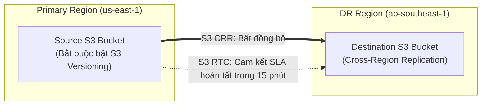
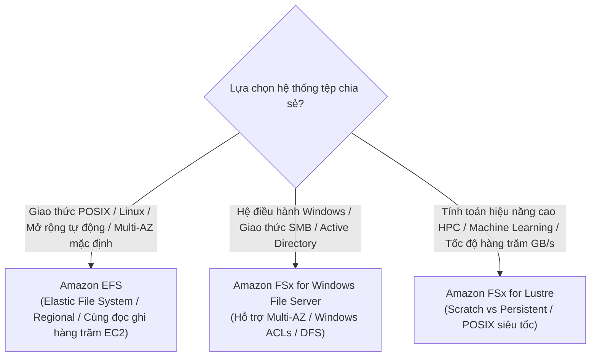

# 💾 Storage Durability & Data Resiliency: S3, EBS, EFS & FSx

> Thuộc: [[Task-2.2-Highly-Available-and-Fault-Tolerant]] | So sánh nhanh: [[Matrix-Storage-Resilience-EBS-vs-EFS-vs-S3]] | Trở về: [[00-Domain-2-MOC]]

---

## 1. Khái niệm cốt lõi (Core Concepts)

Độ bền bỉ của dữ liệu (**Durability**) phản ánh xác suất dữ liệu không bị mất mát theo thời gian, trong khi tính sẵn sàng (**Availability**) phản ánh khả năng truy cập dữ liệu tức thời. Việc lựa chọn công nghệ lưu trữ phù hợp quyết định trực tiếp khả năng chịu lỗi của toàn bộ kiến trúc:
- **Block Storage (Amazon EBS):** Ổ đĩa gắn trực tiếp máy chủ, giới hạn trong 1 Availability Zone.
- **File Storage (Amazon EFS / FSx):** Hệ thống tệp chia sẻ dùng chung cho nhiều máy chủ đồng thời, đa vùng (Multi-AZ).
- **Object Storage (Amazon S3):** Lưu trữ đối tượng phân tán trên Internet, độ bền bỉ đạt 11 số 9 (**99.999999999%**).

---

## 2. Amazon S3: Cơ chế Phục hồi & Sao chép dữ liệu

### Các tính năng phục hồi dữ liệu S3 cần nhớ:
1. **Độ bền bỉ 11 số 9 (11 9's Durability):** Dữ liệu được lưu trữ tự động trên **tối thiểu 3 Availability Zones** độc lập trong cùng một Region.
2. **Cross-Region Replication (CRR):** 
   - Tự động sao chép các object mới upload sang một S3 bucket ở Region khác.
   - **Điều kiện tiên quyết:** Bắt buộc phải **bật S3 Versioning** trên cả bucket nguồn và bucket đích.
   - Hỗ trợ đổi Owner của object và đổi khóa mã hóa KMS giữa 2 tài khoản/vùng.
3. **S3 Replication Time Control (S3 RTC):**
   - Cam kết mức dịch vụ (SLA) sao chép **99.9% dữ liệu trong vòng 15 phút**.
   - Dùng cho các bài thi có yêu cầu tuân thủ pháp lý nghiêm ngặt về thời gian đồng bộ dữ liệu dự phòng.

---

## 3. Amazon EBS: Sao lưu Snapshot & Giới hạn Multi-Attach

### A. Bản chất ràng buộc theo Availability Zone
- Một ổ cứng **EBS Volume bị khóa chặt vào đúng 1 Availability Zone** duy nhất nơi nó được tạo ra.
- EC2 ở AZ-a **không thể** gắn vào EBS Volume nằm ở AZ-b.
- **Giải pháp di chuyển giữa các AZ:** Chụp một bản **EBS Snapshot** (lưu ngầm trên S3), sau đó tạo một volume mới từ Snapshot đó tại AZ mục tiêu.

### B. Fast Snapshot Restore (FSR)
- Thông thường, khi tạo volume mới từ Snapshot, các block dữ liệu đầu tiên đọc từ S3 sẽ bị trễ (độ trễ Lazy Loading).
- **FSR** cho phép volume mới tạo đạt **100% hiệu năng IOPS tối đa ngay tức khắc** mà không bị độ trễ khởi động.

### C. EBS Multi-Attach (Tính năng bẫy đề thi cực lớn!)
- Cho phép gắn 1 volume EBS vào **nhiều máy chủ EC2 cùng một lúc**.
- **Các ràng buộc khắt khe cần học thuộc:**
  1. Chỉ hỗ trợ loại ổ đĩa SSD Provisioned IOPS: **`io1` và `io2`**.
  2. Toàn bộ các máy chủ EC2 **BẮT BUỘC PHẢI NẰM TRONG CÙNG 1 AVAILABILITY ZONE**.
  3. Ứng dụng phải sử dụng hệ thống tệp dạng Cluster (như GFS2) để tự quản lý khóa ghi đồng thời.

---

## 4. Amazon EFS vs Amazon FSx: Hệ thống tệp dùng chung

### So sánh chi tiết EFS vs FSx

| Tiêu chí | Amazon EFS | Amazon FSx for Windows | Amazon FSx for Lustre |
| :--- | :--- | :--- | :--- |
| **Hệ điều hành chính** | **Linux (POSIX)** | **Windows / Windows Server** | **Linux (HPC / Big Data)** |
| **Giao thức mạng** | **NFSv4** | **SMB (Server Message Block)** | **Lustre client** |
| **Tính khả dụng Multi-AZ**| **Mặc định Multi-AZ (Regional)** | Hỗ trợ cấu hình **Single-AZ hoặc Multi-AZ** | Tùy chọn Persistent (HA trong 1 AZ) hoặc Scratch |
| **Khả năng mở rộng dung lượng**| Tự động co giãn (Serverless) | Tăng dung lượng thủ công | Cấu hình theo dung lượng lưu trữ |
| **Tích hợp S3** | Không trực tiếp | Không trực tiếp | **Đọc/ghi trực tiếp liên kết với S3 Bucket** |

---

## 5. Quản lý sao lưu tập trung: AWS Backup

- Thay vì viết script chụp snapshot thủ công cho từng dịch vụ:
- **AWS Backup** cung cấp chính sách sao lưu tập trung (**Backup Plans**), tự động hóa lịch chụp, thời gian lưu giữ (Retention), chuyển đổi dữ liệu lạnh (Lifecycle sang Cold Storage), và hỗ trợ sao chép bản sao lưu sang **Region khác (Cross-Region Backup)** hoặc **Tài khoản khác (Cross-Account Backup)** nhằm phòng chống tấn công ransomware.
- Hỗ trợ: EC2, EBS, RDS, Aurora, DynamoDB, EFS, FSx, S3.

---

## ⚠️ Bẫy đề thi & Mẹo ghi nhớ (Exam Traps)

| Tình huống đề thi | Đáp án bẫy (SAI) | Đáp án chuẩn (ĐÚNG) |
| :--- | :--- | :--- |
| Hàng chục máy chủ EC2 Linux ở nhiều AZ cần cùng chia sẻ và đọc/ghi một thư mục file code | Dùng EBS Multi-Attach (EBS Multi-Attach chỉ chạy trong 1 AZ) | Triển khai **Amazon EFS** (hệ thống tệp Multi-AZ chia sẻ qua giao thức NFS) |
| Cần chia sẻ file dùng chung cho các máy chủ Windows EC2 tích hợp Active Directory doanh nghiệp | Sử dụng Amazon EFS (EFS dùng giao thức NFS của Linux) | Triển khai **Amazon FSx for Windows File Server (chọn Multi-AZ)** |
| Ứng dụng tính toán hiệu năng cao (HPC) cần đọc ghi dữ liệu từ S3 với tốc độ hàng triệu IOPS | Dùng S3 Standard trực tiếp | Triển khai **Amazon FSx for Lustre** liên kết trực tiếp với S3 bucket |
| Yêu cầu sao chép đối tượng S3 sang Region thứ hai với cam kết hoàn tất trong vòng 15 phút | Dùng S3 Cross-Region Replication thông thường | Bật **S3 Cross-Region Replication kết hợp S3 Replication Time Control (S3 RTC)** |

---

## 🔗 Liên kết liên quan
- [[Task-2.2-Highly-Available-and-Fault-Tolerant]]
- [[Matrix-Storage-Resilience-EBS-vs-EFS-vs-S3]]
- [[Disaster-Recovery-Strategies-RTO-RPO]]
- [[RDS-and-Aurora-High-Availability]]
