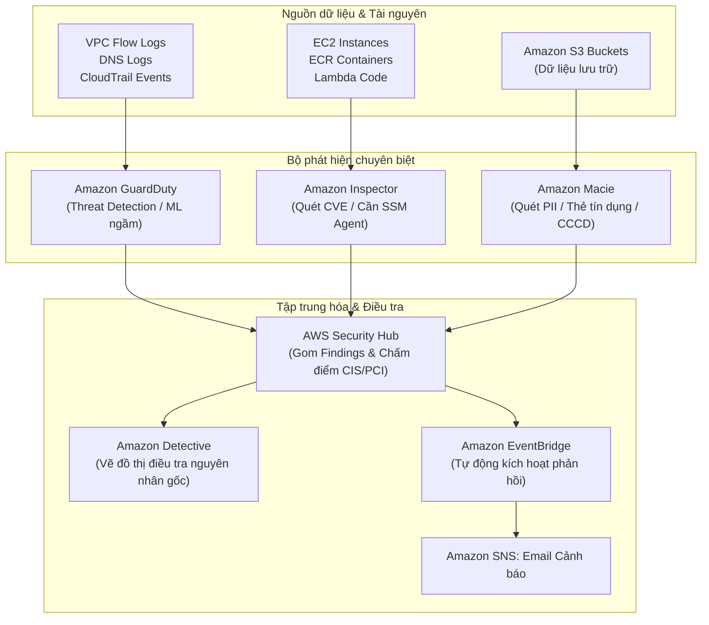

# 🔍 Threat Detection & Auditing: Phân biệt 5 công cụ bảo mật AI/ML

> Thuộc: [[Task-1.2-Design-Secure-Workloads-Apps]] | So sánh nhanh: [[Matrix-Security-Detection-Tools]] | Trở về: [[00-Domain-1-MOC]]

---

## 1. Khái niệm cốt lõi (Core Concepts)

AWS cung cấp một hệ sinh thái các dịch vụ giám sát và kiểm toán an ninh chuyên biệt. Việc nhầm lẫn vai trò của các dịch vụ này là một trong những nguyên nhân mất điểm phổ biến nhất trong bài thi SAA-C03:
- **Amazon GuardDuty:** Phát hiện mối đe dọa xâm nhập thời gian thực (**Intelligent Threat Detection**) không cần cài Agent.
- **Amazon Inspector:** Quét lỗ hổng bảo mật phần mềm (**Vulnerability CVE Scanning**) trên máy chủ, container và code Lambda.
- **Amazon Macie:** Phát hiện và phân loại dữ liệu nhạy cảm (**PII Discovery**) nằm trong các S3 bucket.
- **AWS Security Hub:** Bảng điều khiển trung tâm (**Single Pane of Glass**) gom kết quả cảnh báo và chấm điểm tuân thủ bảo mật (Compliance Score).
- **Amazon Detective:** Truy tìm nguyên nhân gốc rễ (**Root Cause Analysis**) bằng biểu đồ tương tác đồ họa (Graph Model).
- **AWS CloudTrail:** Nhật ký kiểm toán toàn bộ các lệnh gọi API trên tài khoản AWS.

---

## 2. Kiến trúc tương tác giữa các dịch vụ An ninh

---

## 3. Bảng so sánh 5 dịch vụ bảo mật trọng tâm

| Tiêu chí | Amazon GuardDuty | Amazon Inspector | Amazon Macie | AWS Security Hub | Amazon Detective |
| :--- | :--- | :--- | :--- | :--- | :--- |
| **Mục đích chính** | **Phát hiện hành vi độc hại & xâm nhập** | **Quét lỗ hổng bảo mật phần mềm (CVE)** | **Phát hiện dữ liệu nhạy cảm (PII)** | **Bảng điều khiển tập trung & Tuân thủ** | **Điều tra chuyên sâu nguyên nhân gốc** |
| **Đối tượng phân tích**| VPC Flow Logs, DNS Logs, CloudTrail, S3 data events, EKS audit logs. | EC2 (HĐH & thư viện), Container Images trong ECR, AWS Lambda functions. | Các đối tượng và file lưu trữ bên trong **Amazon S3**. | Nhận Findings từ GuardDuty, Inspector, Macie, Firewall Manager. | Sử dụng dữ liệu log từ GuardDuty, VPC Flow Logs, CloudTrail để dựng Graph. |
| **Cần cài Agent?** | **KHÔNG** (Hoàn toàn Serverless, đọc log ngầm). | **CÓ đối với EC2** (Cần AWS Systems Manager Agent); ECR & Lambda không cần agent. | **KHÔNG** (Đọc trực tiếp S3 objects). | Không (Tích hợp API). | Không (Phân tích dữ liệu ngầm). |
| **Ví dụ phát hiện** | - EC2 đào tiền ảo (Crypto mining). - Truy cập từ IP Tor/Malicious. - API call bất thường từ quốc gia lạ. | - Gói phần mềm cài trên EC2 có mã lỗ hổng CVE-2023-xxxx. - EC2 bị hở cổng ra ngoài internet. | - File Excel trên S3 chứa danh sách số thẻ tín dụng hoặc hộ chiếu. | - Điểm tuân thủ CIS Benchmark đạt 85%. - Cảnh báo có 5 High Findings. | - Dựng biểu đồ liên kết: IP nào đăng nhập User nào vào giờ nào để xóa database. |

---

## 4. AWS CloudTrail: Nhật ký kiểm toán API

CloudTrail là nền tảng ghi lại lịch sử *"Ai đã làm gì, vào lúc nào, từ địa chỉ IP nào trên AWS"*:
- **Management Events:** Ghi lại các thao tác cấu hình tài nguyên (ví dụ: `CreateBucket`, `RunInstances`, `AttachRolePolicy`). Mặc định được bật và miễn phí lưu 90 ngày (Event History).
- **Data Events:** Ghi lại các thao tác đọc/ghi vào dữ liệu (ví dụ: `s3:GetObject`, `s3:PutObject`, `lambda:Invoke`). Mặc định **bị tắt** để tiết kiệm chi phí; cần bật thủ công nếu muốn kiểm toán chi tiết.
- **CloudTrail Insights:** Tự động phát hiện hành vi gọi API bất thường (ví dụ: số lượng request `AuthorizeSecurityGroupIngress` tăng đột biến).
- **Log File Integrity Validation:** Tính năng băm SHA-256 mã hóa chữ ký số để chứng minh file log lưu trên S3 **chưa từng bị chỉnh sửa hay xóa** (quan trọng cho các bài thi yêu cầu kiểm toán pháp lý).

---

## ⚠️ Bẫy đề thi & Mẹo ghi nhớ (Exam Traps)

| Từ khóa trong đề thi | Dịch vụ tương ứng (Đáp án ĐÚNG) | Bẫy thường gặp (Đáp án SAI) |
| :--- | :--- | :--- |
| *"Detect cryptocurrency mining or compromised EC2 instances"* | **Amazon GuardDuty** | Amazon Inspector (Inspector chỉ quét lỗ hổng mã code/CVE, không phát hiện máy đang chạy ngầm đào coin) |
| *"Scan container images in ECR for software vulnerabilities (CVE)"* | **Amazon Inspector** | Amazon GuardDuty |
| *"Discover accidentally exposed credit card numbers or PII in S3"* | **Amazon Macie** | Amazon GuardDuty / Amazon Inspector |
| *"Single pane of glass for security posture and compliance with CIS benchmarks"*| **AWS Security Hub** | Amazon CloudWatch |
| *"Visualize and conduct root cause analysis of a security breach"* | **Amazon Detective** | Amazon Athena / CloudWatch Logs Insights |
| *"Ensure audit logs stored in S3 have not been tampered with"* | Bật **CloudTrail Log File Integrity Validation** | S3 Versioning đơn thuần (Versioning không ngăn được việc sửa log nếu không có bằng chứng chữ ký số) |

---

## 🔗 Liên kết liên quan
- [[Task-1.2-Design-Secure-Workloads-Apps]]
- [[Matrix-Security-Detection-Tools]]
- [[Edge-and-App-Defense]]
- [[Domain-1-Scenario-Walkthroughs]]
