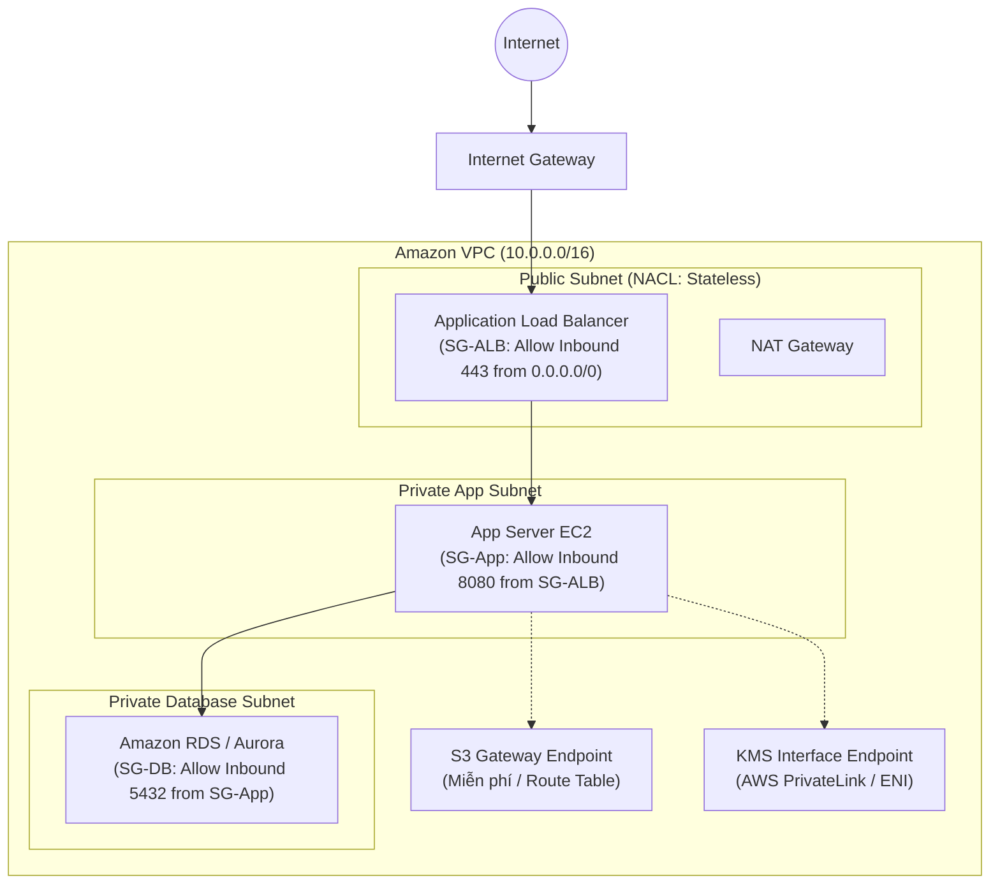
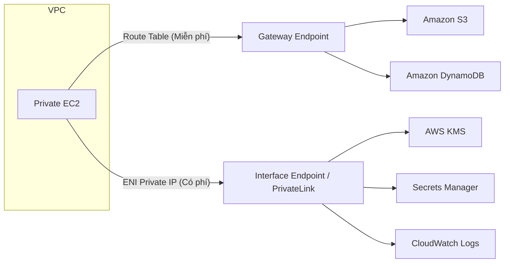

# 🛡️ VPC Network Security Layers: Multi-Layer Isolation & Endpoints

> Thuộc: [[Task-1.2-Design-Secure-Workloads-Apps]] | So sánh nhanh: [[Matrix-SG-vs-NACL]] | Trở về: [[00-Domain-1-MOC]]

---

## 1. Khái niệm cốt lõi (Core Concepts)

Mô hình bảo vệ mạng trong AWS áp dụng nguyên tắc **Phòng thủ đa tầng (Defense in Depth)**. Một gói tin đi từ Internet vào cơ sở dữ liệu phải vượt qua tối thiểu 3 lớp kiểm soát:
1. **Lớp Subnet:** Được bảo vệ bởi **Network ACLs (NACL)**.
2. **Lớp Instance / Network Interface (ENI):** Được bảo vệ bởi **Security Groups (SG)**.
3. **Lớp Định tuyến & Dịch vụ:** Được cô lập bởi **Private Subnets** và **VPC Endpoints**.

---

## 2. Kiến trúc mạng phân lớp chuẩn trong SAA-C03

---

## 3. Security Groups vs Network ACLs: So sánh bản chất

| Tiêu chí | Security Group (SG) | Network ACL (NACL) |
| :--- | :--- | :--- |
| **Cấp độ áp dụng** | **Instance / ENI** (Giao diện mạng) | **Subnet** (Toàn bộ subnet) |
| **Trạng thái (State)** | **Stateful (Có trạng thái):** Nếu Inbound cho phép, Outbound trả về tự động được mở (bất kể Outbound rules). | **Stateless (Không có trạng thái):** Chiều Inbound và Outbound hoàn toàn độc lập, phải cấu hình cả 2 chiều. |
| **Loại luật hỗ trợ** | **Chỉ có ALLOW** (Mặc định Deny tất cả) | **Cả ALLOW và DENY** |
| **Thứ tự xét luật** | Đánh giá **đồng thời tất cả các rules**. | Xét theo **số thứ tự (Rule Number)** từ thấp đến cao (1-32766), gặp luật khớp là dừng ngay. |
| **Tham chiếu (Targeting)** | Có thể điền CIDR block hoặc **ID của SG khác** (`sg-xxxx`). | **Chỉ nhận dải IP CIDR block**, không thể nhận SG ID. |
| **Cổng phản hồi** | Tự động xử lý ngầm. | **Bắt buộc mở Ephemeral Ports (1024-65535)** ở Outbound cho lưu lượng hồi đáp. |

---

## 4. Kỹ thuật xâu chuỗi Security Groups (SG Chaining)

Một trong những thiết kế bảo mật được đánh giá cao nhất trong bài thi SAA-C03 là **không bao giờ mở port cho dải IP Subnet nếu không bắt buộc**, mà sử dụng **Security Group Chaining**:
1. `SG-ALB`: Cho phép Inbound port 443 từ `0.0.0.0/0`.
2. `SG-App`: Chỉ cho phép Inbound port 8080 từ nguồn là **`SG-ALB`**.
3. `SG-DB`: Chỉ cho phép Inbound port 5432 từ nguồn là **`SG-App`**.

> **Lợi ích kiến trúc:** Cho dù các máy chủ App hay Database có thay đổi địa chỉ IP (do Auto Scaling) thì kết nối vẫn an toàn và không bao giờ bị lộ ra ngoài.

---

## 5. Kết nối riêng tư: Gateway Endpoint vs Interface Endpoint

Khi tài nguyên trong Private Subnet cần kết nối tới dịch vụ AWS (như S3, DynamoDB, KMS, Secrets Manager) mà **không muốn dữ liệu đi ra Internet qua NAT Gateway**:

| Tiêu chí | Gateway Endpoint | Interface Endpoint (AWS PrivateLink) |
| :--- | :--- | :--- |
| **Dịch vụ hỗ trợ** | **Chỉ S3 và DynamoDB** | **Hầu hết các dịch vụ AWS** (KMS, SSM, SQS, SNS...) + Custom Services |
| **Cơ chế triển khai** | Cập nhật **Route Table** của VPC | Tạo một **Elastic Network Interface (ENI)** có Private IP trong Subnet |
| **Chi phí** | **Hoàn toàn miễn phí** | **Có phí** (Tính theo giờ hoạt động của ENI + Phí truyền tải dữ liệu GB) |
| **Truy cập từ On-Premises** | **Không** (chỉ dành cho tài nguyên nội bộ VPC) | **Có** (qua Direct Connect hoặc Site-to-Site VPN) |

---

## 6. AWS Systems Manager Session Manager

Trong quá khứ, giải pháp truyền thống để quản trị máy chủ EC2 trong Private Subnet là dựng một **Bastion Host (Jump Box)** trong Public Subnet và mở cổng SSH (22) hoặc RDP (3389).

### Vì sao SAA-C03 ưu tiên Session Manager?
- **Không cần mở bất kỳ cổng Inbound nào** (cổng 22/3389 đóng hoàn toàn).
- **Không cần cấp Public IP** cho EC2.
- **Không cần quản lý SSH Key pair** (tránh rủi ro mất private key).
- Xác thực và phân quyền trực tiếp qua **IAM Policies** và **IAM Identity Center**.
- Toàn bộ lệnh gõ và phiên làm việc được ghi log đầy đủ vào **S3** hoặc **CloudWatch Logs** phục vụ kiểm toán an ninh.

---

## ⚠️ Bẫy đề thi & Mẹo ghi nhớ (Exam Traps)

| Tình huống đề thi | Đáp án bẫy (SAI) | Đáp án chuẩn (ĐÚNG) |
| :--- | :--- | :--- |
| Chặn một dải IP tin tặc cụ thể tấn công máy chủ | Tạo Deny Rule trong Security Group (SG không có Deny) | Tạo **Rule Deny trong Network ACL** với số thứ tự ưu tiên cao hơn (ví dụ Rule 50 Deny, Rule 100 Allow) |
| EC2 trong Private Subnet gọi S3, yêu cầu chi phí thấp nhất và không qua Internet | Dùng NAT Gateway hoặc tạo Interface Endpoint | Tạo **VPC Gateway Endpoint cho S3** (miễn phí, thêm tuyến đường vào Route Table) |
| Máy chủ EC2 không thể tải gói cài đặt từ client dù NACL Inbound đã mở port 80/443 | Kiểm tra Security Group | NACL là Stateless, bắt buộc phải mở **NACL Outbound Ephemeral Ports (1024-65535)** để gói tin phản hồi có thể đi ra |
| Quản trị viên cần SSH vào EC2 trong private subnet với ít công sức quản lý hạ tầng nhất | Dựng Auto Scaling Bastion Host trong public subnet | Sử dụng **AWS Systems Manager Session Manager** |

---

## 🔗 Liên kết liên quan
- [[Task-1.2-Design-Secure-Workloads-Apps]]
- [[Matrix-SG-vs-NACL]]
- [[Edge-and-App-Defense]]
- [[Domain-1-Scenario-Walkthroughs]]
