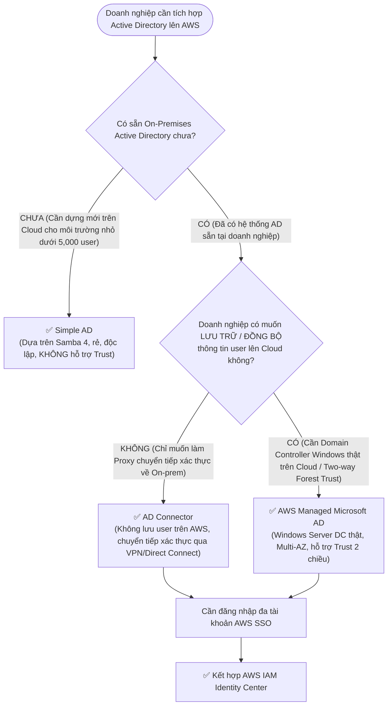

# ⚖️ Decision Matrix: Active Directory Integration Modes

> Deep Dive chi tiết: [[Directory-Service-and-IAM-Identity-Center]] | Trở về: [[00-Domain-1-MOC]]

---

## 1. Sơ đồ cây quyết định trong đề thi (Decision Flowchart)

---

## 2. Bảng so sánh 3 tùy chọn AWS Directory Service

| Tiêu chí so sánh | AWS Managed Microsoft AD | AD Connector | Simple AD |
| :--- | :--- | :--- | :--- |
| **Bản chất công nghệ** | **Windows Server Active Directory thật** do AWS quản lý Multi-AZ | **Directory Gateway Proxy** (Không phải Domain Controller) | **Samba 4 Open Source** tương thích giao thức AD |
| **Lưu trữ User trên Cloud?**| **CÓ** (Lưu trong Domain Controller trên AWS) | **KHÔNG** (Chỉ chuyển tiếp truy vấn về On-Prem AD) | **CÓ** (Lưu độc lập trên Samba) |
| **Hỗ trợ Forest Trust?** | **CÓ (One-way và Two-way Forest Trust)** | Không áp dụng (Bản thân nó chỉ là client proxy) | **KHÔNG** (Không hỗ trợ Trust) |
| **Windows Group Policy (GPO)?**| **Đầy đủ** | Lấy từ On-Premises AD | Hỗ trợ cơ bản |
| **Quy mô khuyến nghị** | Doanh nghiệp lớn (> 5,000 users) | Mọi quy mô có sẵn On-prem AD | Quy mô nhỏ (< 5,000 users) |
| **Tích hợp AWS IAM Identity Center**| **Hỗ trợ** | **Hỗ trợ** | Không hỗ trợ |

---

## 3. Bảng phản xạ nhanh từ khóa đề thi (Keyword Triggers)

| Cụm từ khóa trong đề thi SAA-C03 | Dịch vụ được chọn |
| :--- | :--- |
| *"Establish a two-way forest trust relationship between on-premises AD and AWS"* | **AWS Managed Microsoft AD** |
| *"Use existing on-premises Active Directory credentials without caching or storing them in AWS"* | **AD Connector** |
| *"Low-cost standalone directory for basic LDAP/AD compatibility without trust"* | **Simple AD** |
| *"Single sign-on access to multiple AWS accounts integrated with corporate Active Directory"* | **AWS IAM Identity Center** (kết hợp AD Connector hoặc Managed AD) |
| *"Seamless domain-join for Windows EC2 workloads with full Group Policy (GPO) support"* | **AWS Managed Microsoft AD** |
