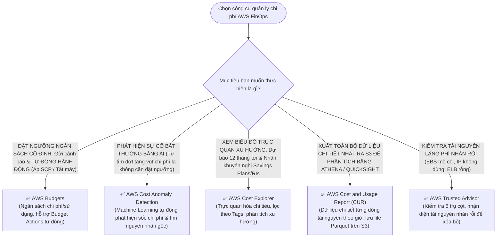

# ⚖️ Decision Matrix: Bộ Công Cụ Quản Lý Chi Phí AWS

> Deep Dive chi tiết: [[AWS-Cost-Governance-Budgets-Anomaly-and-Tags]] | Trở về: [[00-Domain-4-MOC]]

---

## 1. Sơ đồ cây quyết định trong đề thi (Decision Flowchart)

---

## 2. Bảng so sánh trực diện 5 công cụ tài chính đám mây

| Tiêu chí | AWS Cost Explorer | AWS Budgets | AWS Cost Anomaly Detection | AWS Cost and Usage Report (CUR) | AWS Trusted Advisor |
| :--- | :--- | :--- | :--- | :--- | :--- |
| **Bản chất chính** | **Phân tích & Dự báo trực quan** | **Kiểm soát Ngân sách & Hành động** | **Phát hiện Bất thường bằng AI/ML** | **Báo cáo Dữ liệu thô chuyên sâu** | **Khuyến nghị Kiểm toán hạ tầng** |
| **Hình thức giao diện**| Biểu đồ đường, cột trên Console | Thiết lập ngưỡng và cảnh báo | Bảng cảnh báo bất thường | File CSV / Parquet lưu trên S3 | Danh sách Checklists 5 trụ cột |
| **Hành động tự động?**| Không (Chỉ xem) | **CÓ (Budget Actions: SCP, Stop EC2)**| CÓ (Gửi thông báo qua SNS) | Không (Dữ liệu tĩnh) | Không |
| **Dự báo tương lai?** | **CÓ (Lên tới 12 tháng tới)** | **CÓ (Cảnh báo khi dự báo vượt ngưỡng)**| Không (Phát hiện quá khứ/hiện tại)| Không | Không |
| **Gợi ý Savings Plans?**| **CÓ (Khuyến nghị mua chi tiết)**| Không | Không | Không | CÓ (Kiểm tra RI utilization) |
| **Tìm tài nguyên rác?** | Không trực tiếp | Không | Không | Không | **CÓ (EBS unattached, Idle ELB)** |
| **Chi phí sử dụng** | **Miễn phí** (API calls có phí nhỏ)| Miễn phí 2 budgets đầu tiên ($0.02/ngày sau đó)| **Miễn phí** | Miễn phí (Chỉ trả tiền lưu trữ S3)| Miễn phí bản Core / Trả phí gói Support |

---

## 3. Bảng phản xạ nhanh từ khóa đề thi (Keyword Triggers)

| Cụm từ khóa trong đề thi SAA-C03 | Công cụ tài chính được chọn |
| :--- | :--- |
| *"Set custom spending limits and automatically apply a Service Control Policy (SCP) when exceeded"*| **AWS Budgets (with Budget Actions)** |
| *"Machine learning powered tool to detect sudden unexpected cost spikes and determine root cause"*| **AWS Cost Anomaly Detection** |
| *"Visualize historical spending trends over the past 12 months and forecast next year's bill"*| **AWS Cost Explorer** |
| *"Deliver the most comprehensive, granular cost data to Amazon S3 for Athena SQL analytics"*| **AWS Cost and Usage Report (CUR)** |
| *"Identify idle resources such as unattached EBS volumes and underutilized load balancers to reduce costs"*| **AWS Trusted Advisor (Cost pillar)** |
| *"Generate purchase recommendations for Compute Savings Plans and Reserved Instances"*| **AWS Cost Explorer** |
