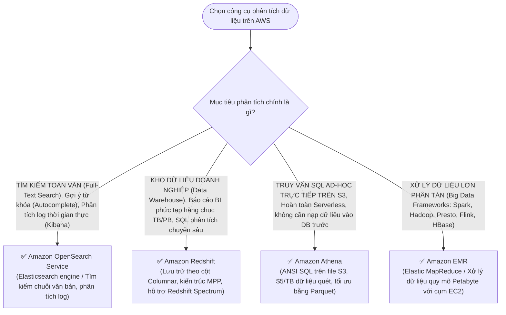

# ⚖️ Decision Matrix: Amazon Athena vs Redshift vs OpenSearch

> Deep Dive chi tiết: [[Data-Lake-Query-Tuning-Athena-Glue-Parquet]] | Trở về: [[00-Domain-3-MOC]]

---

## 1. Sơ đồ cây quyết định trong đề thi (Decision Flowchart)

---

## 2. Bảng so sánh 4 giải pháp phân tích dữ liệu lớn

| Tiêu chí | Amazon Athena | Amazon Redshift | Amazon OpenSearch Service | Amazon EMR |
| :--- | :--- | :--- | :--- | :--- |
| **Bản chất dịch vụ** | **Serverless Interactive Query Service** | **Enterprise Data Warehouse (OLAP)** | **Search & Log Analytics Engine** | **Managed Big Data Frameworks (Hadoop/Spark)** |
| **Vị trí lưu trữ dữ liệu**| **Trực tiếp trên Amazon S3** (Data Lake) | Ổ đĩa chuyên dụng của cụm Redshift (hoặc S3 qua Spectrum) | Ổ đĩa cụm OpenSearch Node (EBS / Storage) | HDFS trên EC2 hoặc S3 (EMRFS) |
| **Ngôn ngữ truy vấn** | **Chuẩn ANSI SQL** (Presto/Trino) | **Chuẩn SQL** (PostgreSQL-based MPP) | **OpenSearch Query DSL / SQL** | Code Spark, Scala, Python, Java, SQL |
| **Cần nạp dữ liệu trước?**| **KHÔNG** (Truy vấn tại chỗ trên S3) | **CÓ** (Phải load bằng lệnh `COPY`) | **CÓ** (Phải nạp/index tài liệu JSON) | Tùy chọn xử lý batch |
| **Tối ưu hóa hiệu năng** | Định dạng **Apache Parquet**, phân vùng | Sort Keys, Distribution Keys, WLM | Shards, Replicas, Index State Management | Cấu hình tham số Spark/YARN |
| **Mô hình tính giá** | **$5.00 / 1 TB dữ liệu được quét** | Tính theo giờ chạy Cluster hoặc Serverless | Tính theo giờ chạy Instance + Dung lượng EBS | Phí EMR + Phí EC2/EBS bên dưới |
| **Ứng dụng tiêu biểu** | Phân tích log ad-hoc, truy vấn data lake định kỳ | Dashboard BI PowerBI/Tableau, báo cáo tài chính lớn | Tìm kiếm sản phẩm trang TMĐT, phân tích log bảo mật | Xử lý ETL khổng lồ, đào tạo mô hình Machine Learning lớn |

---

## 3. Bảng phản xạ nhanh từ khóa đề thi (Keyword Triggers)

| Cụm từ khóa trong đề thi SAA-C03 | Dịch vụ phân tích được chọn |
| :--- | :--- |
| *"Run ad-hoc SQL queries directly on unstructured or semi-structured data in Amazon S3 without loading into a database"*| **Amazon Athena** |
| *"Enterprise data warehouse solution supporting petabytes of data with complex multi-table analytical joins"*| **Amazon Redshift** |
| *"Search catalog with full-text search capabilities, fuzzy matching, and real-time dashboarding"* | **Amazon OpenSearch Service** |
| *"Process large-scale datasets using Apache Spark, Hadoop, or Hive with spot instance clusters"* | **Amazon EMR** |
| *"Run queries spanning data stored in both Redshift and open file formats directly in Amazon S3"* | **Amazon Redshift Spectrum** |
