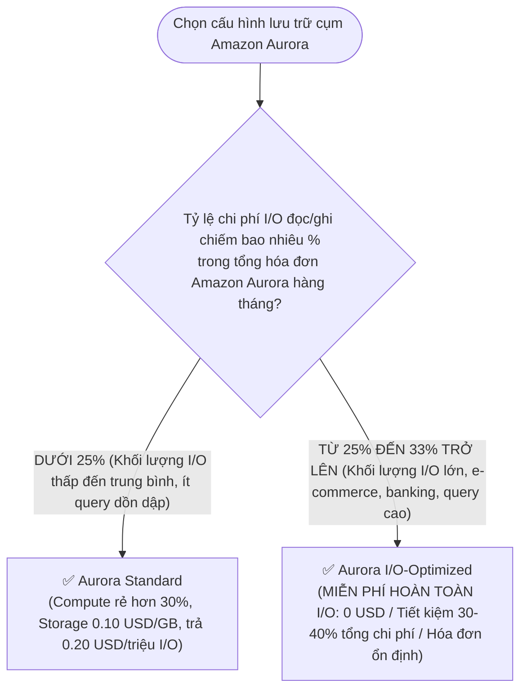

# ⚖️ Decision Matrix: Aurora Standard vs Aurora I/O-Optimized

> Deep Dive chi tiết: [[Aurora-Storage-Configurations-Standard-vs-IO-Optimized]] | Trở về: [[00-Domain-4-MOC]]

---

## 1. Sơ đồ cây quyết định trong đề thi (Decision Flowchart)

---

## 2. Bảng so sánh trực diện 8 tiêu chí kỹ thuật

| Tiêu chí | Amazon Aurora Standard | Amazon Aurora I/O-Optimized |
| :--- | :--- | :--- |
| **Phí gọi I/O (Đọc & Ghi)** | **$0.20 / 1 triệu I/O requests** | **HOÀN TOÀN MIỄN PHÍ ($0.00)** |
| **Phí Compute Instance** | Giá cơ sở chuẩn 100% | Cao hơn khoảng **~30%** |
| **Phí Dung lượng lưu trữ (GB)**| **~$0.10 / GB / tháng** | **~$0.225 / GB / tháng** (Gấp ~2.25 lần) |
| **Tính ổn định của hóa đơn** | Khó dự đoán (Phụ thuộc vào số lượng query/I/O) | **Rất cao (Hóa đơn cố định theo tháng)** |
| **Tỷ lệ I/O tối ưu để chọn** | Khi chi phí I/O < 25% tổng hóa đơn | **Khi chi phí I/O > 25% - 33% tổng hóa đơn** |
| **Mức tiết kiệm tiềm năng** | Rẻ hơn cho ứng dụng ít truy vấn | **Tiết kiệm 30% đến 40% cho ứng dụng I/O cao** |
| **Thời gian chuyển đổi** | 1 cú click (Zero Downtime) | 1 cú click (Zero Downtime) |
| **Động thái khuyến nghị AI** | Compute Optimizer đánh giá "Optimized" | Compute Optimizer báo **"DB cluster storage savings available"** |

---

## 3. Bảng phản xạ nhanh từ khóa đề thi (Keyword Triggers)

| Cụm từ khóa trong đề thi SAA-C03 | Cấu hình Aurora được chọn |
| :--- | :--- |
| *"Aurora MySQL cluster with high I/O charges accounting for 40% of monthly bill, need predictable costs"*| **Amazon Aurora I/O-Optimized** |
| *"Workload with low-to-moderate I/O operations and massive 50 TB storage size"* | **Amazon Aurora Standard** |
| *"Eliminate unpredictable per-request I/O charges for an e-commerce database during flash sales"*| **Amazon Aurora I/O-Optimized** |
| *"Compute Optimizer recommendation: DB cluster storage savings available"* | **Switch to Amazon Aurora I/O-Optimized** |
