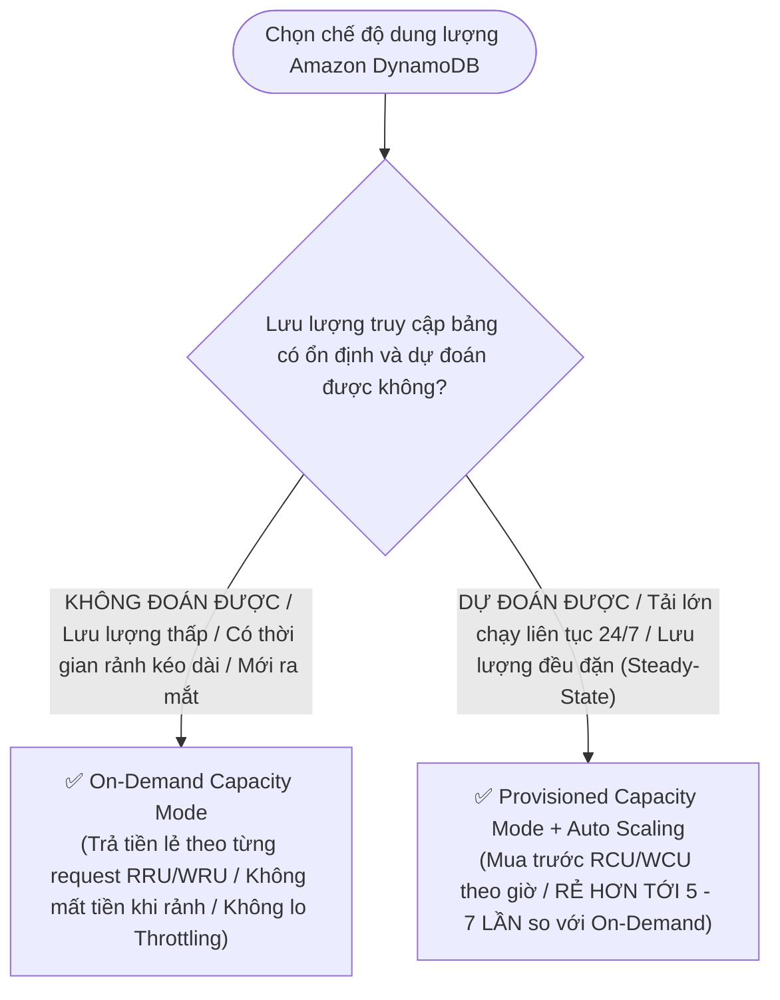

# ⚖️ Decision Matrix: DynamoDB On-Demand vs Provisioned Capacity

> Deep Dive chi tiết: [[DynamoDB-Cost-Models-On-Demand-vs-Provisioned]] | Trở về: [[00-Domain-4-MOC]]

---

## 1. Sơ đồ cây quyết định trong đề thi (Decision Flowchart)

---

## 2. Bảng so sánh trực diện 8 tiêu chí kỹ thuật

| Tiêu chí | On-Demand Mode | Provisioned Mode (kèm Auto Scaling) |
| :--- | :--- | :--- |
| **Cơ chế tính cước** | **Trả theo từng Request thực tế (RRU / WRU)** | **Trả theo số lượng RCU / WCU đã cấp phát theo giờ** |
| **Độ phức tạp vận hành** | **Bằng 0 (Hoàn toàn tự động 100%)** | Cần theo dõi CloudWatch và đặt ngưỡng min/max |
| **Chi phí khi hệ thống rảnh (Idle)**| **$0.00** (Không có request = Không tốn tiền) | Vẫn phải trả tiền cho mức RCU/WCU tối thiểu đã mua |
| **Chi phí khi tải cao liên tục 24/7**| **Rất đắt** | **Rẻ hơn từ 5 đến 7 lần** |
| **Khả năng thích ứng tải sốc** | Thích ứng tức thì (Lên tới gấp đôi đỉnh trước)| Auto Scaling mất vài phút để tăng dung lượng |
| **Rủi ro Throttling** | Gần như không | Có thể bị `ProvisionedThroughputExceededException` |
| **Đổi chế độ** | Có thể đổi sang Provisioned bất kỳ lúc nào | Cho phép đổi sang On-Demand 1 lần mỗi 24 giờ |
| **Kịch bản phù hợp** | Sản phẩm mới ra mắt, ứng dụng nội bộ ít dùng | **Hệ thống Production lớn, tải đều đặn quanh năm** |

---

## 3. Bảng phản xạ nhanh từ khóa đề thi (Keyword Triggers)

| Cụm từ khóa trong đề thi SAA-C03 | Chế độ dung lượng được chọn |
| :--- | :--- |
| *"Workload with unknown traffic patterns or long idle periods with zero capacity planning"*| **DynamoDB On-Demand Capacity Mode** |
| *"High-volume production workload with predictable, steady-state read and write traffic at lowest cost"*| **DynamoDB Provisioned Capacity Mode with Auto Scaling** |
| *"Application experiences sudden spikes up to double previous peak without any throttling"*| **DynamoDB On-Demand Capacity Mode** |
| *"Reduce read costs on DynamoDB table by 50% without altering data structure"*| **Switch from Strongly Consistent to Eventually Consistent Reads** |
