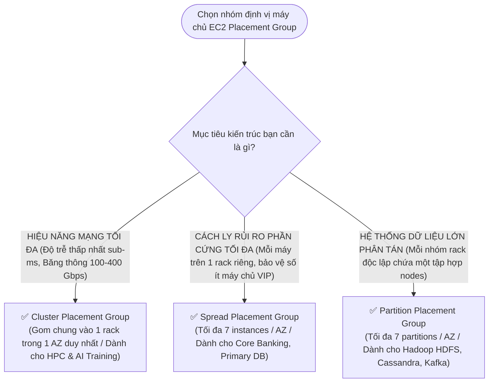

# ⚖️ Decision Matrix: Amazon EC2 Placement Groups

> Deep Dive chi tiết: [[EC2-Placement-Groups-and-HPC-Accelerators]] | Trở về: [[00-Domain-3-MOC]]

---

## 1. Sơ đồ cây quyết định trong đề thi (Decision Flowchart)

---

## 2. Bảng so sánh toàn diện 3 loại Placement Groups

| Tiêu chí kỹ thuật | Cluster Placement Group | Spread Placement Group | Partition Placement Group |
| :--- | :--- | :--- | :--- |
| **Vị trí vật lý** | **Cùng 1 rack phần cứng** trong 1 AZ | **Các rack riêng biệt hoàn toàn** | Gom thành các phân vùng (**Partitions**) trên các rack riêng |
| **Độ trễ mạng giữa các node**| **Thấp nhất có thể (Sub-ms)** | Chuẩn mạng AWS | Chuẩn mạng AWS |
| **Băng thông mạng tối đa**| **100 Gbps đến 400 Gbps** | Băng thông instance chuẩn | Băng thông instance chuẩn |
| **Phạm vi triển khai** | **Chỉ trong 1 AZ duy nhất** | Có thể trải dài **nhiều AZs** | Có thể trải dài **nhiều AZs** |
| **Giới hạn số lượng máy**| Khuyến nghị cùng loại instance | **Tối đa 7 instances mỗi AZ** | **Tối đa 7 partitions mỗi AZ** (chứa hàng trăm máy) |
| **Phạm vi ảnh hưởng khi hỏng**| **Rộng nhất** (Rack hỏng = hỏng cả cụm) | **Nhỏ nhất** (Hỏng 1 rack chỉ mất 1 máy) | **Theo Partition** (Chỉ ảnh hưởng 1 partition bị hỏng) |
| **Ứng dụng tiêu biểu** | **HPC, AI/ML Deep Learning, MPI, Mô phỏng khoa học** | **Máy chủ quan trọng sống còn, Primary DB, Domain Controllers** | **Hadoop HDFS, Apache Cassandra, Apache Kafka, ScyllaDB** |

---

## 3. Bảng phản xạ nhanh từ khóa đề thi (Keyword Triggers)

| Cụm từ khóa trong đề thi SAA-C03 | Loại Placement Group được chọn |
| :--- | :--- |
| *"Tightly coupled HPC workload requiring lowest possible network latency and high throughput"* | **Cluster Placement Group** |
| *"Isolate a small fleet of mission-critical instances on separate underlying hardware racks"* | **Spread Placement Group** |
| *"Distributed big data cluster (HDFS / Cassandra) spanning hundreds of instances across racks"* | **Partition Placement Group** |
| *"Cannot launch more than 7 instances in a single AZ with this placement group"* | **Spread Placement Group** |
| *"Recommended to launch all instances in a single launch request to prevent capacity errors"* | **Cluster Placement Group** |
