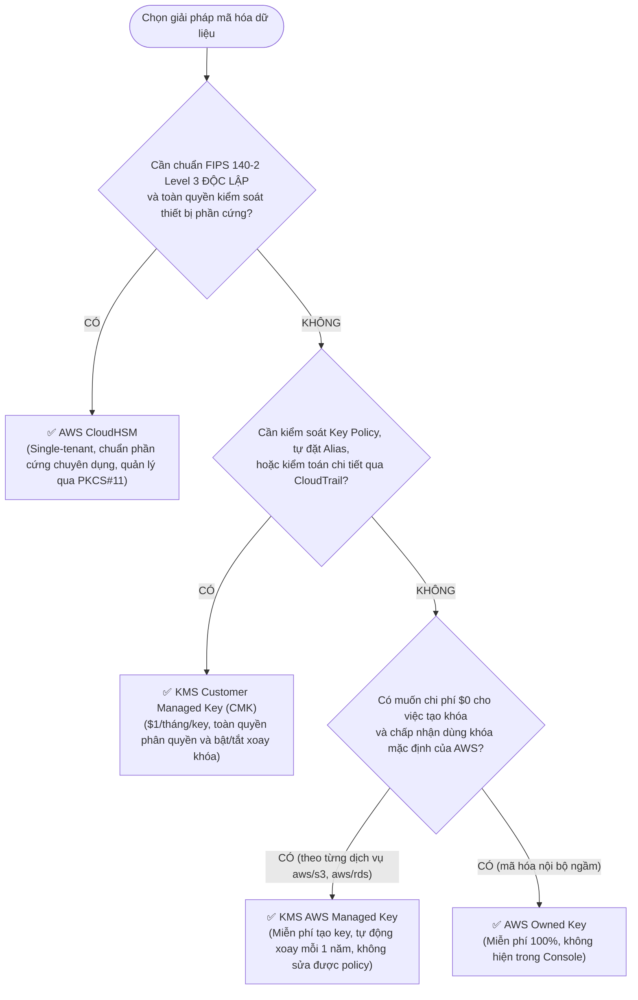

# ⚖️ Decision Matrix: AWS KMS Key Types & Cryptographic Options

> Deep Dive chi tiết: [[AWS-KMS-and-CloudHSM]] | Trở về: [[00-Domain-1-MOC]]

---

## 1. Sơ đồ cây quyết định trong đề thi (Decision Flowchart)

---

## 2. Bảng so sánh 5 loại khóa mã hóa trên AWS

| Đặc tính kỹ thuật | AWS Owned Keys | AWS Managed Keys | Customer Managed Keys (CMK) | AWS CloudHSM | External Key Store (XKS) |
| :--- | :--- | :--- | :--- | :--- | :--- |
| **Phí tạo khóa** | **Miễn phí ($0)** | **Miễn phí ($0)** | **$1 / key / tháng** | Hàng nghìn USD/tháng | Phí KMS + Chi phí HSM On-prem |
| **Hiển thị Console**| Không hiển thị | Có (`aws/s3`, `aws/ebs`) | Tự đặt tên `alias/xxxx` | Quản lý qua HSM CLI | Thông qua KMS Console |
| **Sửa Key Policy** | Không thể | Không thể | **Toàn quyền cấu hình** | Toàn quyền kiểm soát | Kiểm soát tại HSM ngoài |
| **Xoay khóa (Rotation)**| AWS tự quản lý | **Tự động mỗi 1 năm** | Tùy chọn (Bật xoay 1 năm hoặc thủ công)| Khách hàng tự xoay | Khách hàng tự xoay |
| **Xóa khóa** | Không thể | Không thể | **Có** (Chờ 7-30 ngày) | **Có** (Xóa tức thì) | Khách hàng tự xóa |
| **Chuẩn phần cứng** | FIPS 140-2 L2/L3 | FIPS 140-2 L2/L3 | FIPS 140-2 L2/L3 | **FIPS 140-2 Level 3 (Dedicated)** | Tùy chọn On-premise HSM |

---

## 3. Symmetric vs Asymmetric Keys

| Tiêu chí | Khóa đối xứng (Symmetric Keys) | Khóa bất đối xứng (Asymmetric Keys) |
| :--- | :--- | :--- |
| **Thuật toán** | **AES-256** | **RSA** hoặc **ECC (Elliptic Curve)** |
| **Cấu trúc khóa** | Duy nhất 1 khóa dùng chung cho cả Mã hóa và Giải mã. | Gồm 1 cặp: **Public Key** (Mã hóa / Verify) và **Private Key** (Giải mã / Sign). |
| **Khả năng tải về**| **Không bao giờ rời khỏi KMS** ở dạng unencrypted. | **Public Key có thể tải về** để chia sẻ ra bên ngoài AWS. |
| **Ứng dụng tiêu biểu**| Mã hóa dữ liệu lưu trữ S3, EBS, RDS (chiếm 95% câu hỏi SAA-C03). | Ký số tài liệu điện tử, mã hóa dữ liệu từ đối tác ngoài AWS gửi vào mà không cấp quyền truy cập AWS. |

---

## 4. Single-Region vs Multi-Region Keys

- **KMS thông thường (Single-Region):** Gắn liền với Region tạo ra. Không thể giải mã dữ liệu ở Region khác.
- **KMS Multi-Region Keys:** Khóa có cùng Key ID và Key Material được nhân bản giữa nhiều Region.
- **Quy tắc thi cử:** Chọn **Multi-Region Keys** khi câu hỏi mô tả kịch bản **Multi-Region Disaster Recovery, DynamoDB Global Tables, hoặc Aurora Global Databases** yêu cầu mã hóa đồng nhất mà không cần decrypt rồi re-encrypt qua đường truyền mạng.
