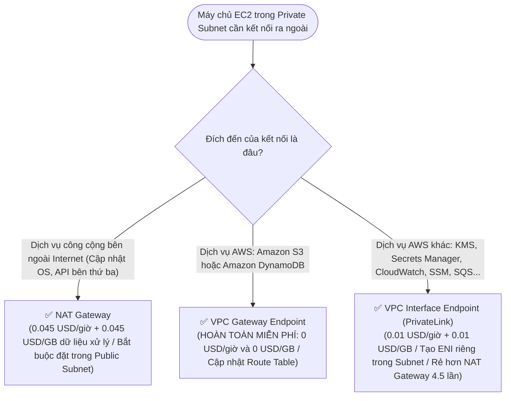

# ⚖️ Decision Matrix: NAT Gateway vs VPC Endpoints

> Deep Dive chi tiết: [[Data-Transfer-Costs-and-VPC-Endpoints-vs-NAT]] | Trở về: [[00-Domain-4-MOC]]

---

## 1. Sơ đồ cây quyết định trong đề thi (Decision Flowchart)

---

## 2. Bảng so sánh trực diện 8 tiêu chí kỹ thuật

| Tiêu chí so sánh | NAT Gateway | VPC Gateway Endpoint | VPC Interface Endpoint (PrivateLink) |
| :--- | :--- | :--- | :--- |
| **Dịch vụ hỗ trợ** | Tất cả lưu lượng Internet | **Chỉ Amazon S3 & DynamoDB** | Hầu hết các dịch vụ AWS khác + Custom Services |
| **Phí duy trì theo giờ** | **$0.045 / giờ / NAT** (~$32.40/tháng) | **HOÀN TOÀN MIỄN PHÍ ($0)** | $0.01 / giờ / AZ (~$7.20/tháng) |
| **Phí xử lý dữ liệu (GB)**| **$0.045 / GB dữ liệu** (Cực đắt khi tải nhiều TB) | **HOÀN TOÀN MIỄN PHÍ ($0 / GB)** | **$0.01 / GB** (Rẻ hơn NAT Gateway 4.5 lần) |
| **Cách triển khai** | Cần Elastic IP trong Public Subnet | Cập nhật **Route Table** của Subnet | Tạo **ENI** có Private IP trong Subnet |
| **Cần Internet Gateway?** | **CÓ** (Bắt buộc) | **KHÔNG** (Dữ liệu đi trong mạng AWS) | **KHÔNG** (Dữ liệu đi trong mạng AWS) |
| **Truy cập từ On-Premise**| Không | Không | **CÓ** (Qua VPN / Direct Connect) |
| **Bảo mật** | Gói tin đi ra cổng mạng công cộng | Rất cao (Không bao giờ rời mạng AWS) | Rất cao (Không bao giờ rời mạng AWS) |
| **Khuyến nghị chi phí** | Chỉ dùng cho Internet outbound chung | **BẮT BUỘC DÙNG cho S3 & DynamoDB** | Ưu tiên dùng khi truyền dữ liệu lớn tới KMS/SSM |

---

## 3. Bảng phản xạ nhanh từ khóa đề thi (Keyword Triggers)

| Cụm từ khóa trong đề thi SAA-C03 | Thành phần mạng được chọn |
| :--- | :--- |
| *"Eliminate massive NAT Gateway data processing charges for EC2 accessing Amazon S3"*| **VPC Gateway Endpoint for S3 (Route Table)** |
| *"Connect privately and cost-effectively from private subnet to DynamoDB at zero cost"*| **VPC Gateway Endpoint for DynamoDB** |
| *"Enable private EC2 instances to download Linux OS software patches from the Internet"*| **NAT Gateway (đặt trong Public Subnet)** |
| *"Access AWS KMS or Secrets Manager from on-premises over Direct Connect without Internet"*| **VPC Interface Endpoint (AWS PrivateLink)** |
