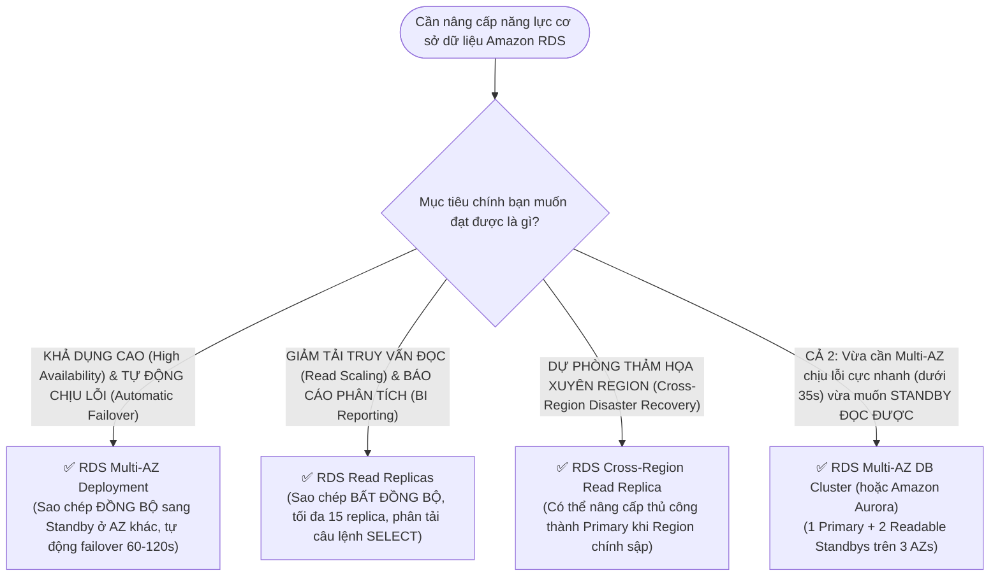

# ⚖️ Decision Matrix: RDS Multi-AZ vs Read Replicas

> Deep Dive chi tiết: [[RDS-and-Aurora-High-Availability]] | Trở về: [[00-Domain-2-MOC]]

---

## 1. Sơ đồ cây quyết định trong đề thi (Decision Flowchart)

---

## 2. Bảng so sánh trực diện 10 tiêu chí

| Tiêu chí kỹ thuật | RDS Multi-AZ Instance | RDS Read Replicas | RDS Multi-AZ Cluster | Amazon Aurora |
| :--- | :--- | :--- | :--- | :--- |
| **Mục đích chính** | **Khả dụng cao (HA / DR)** | **Hiệu năng đọc (Read Scale)**| **Vừa HA vừa Read Scale** | **HA đỉnh cao + Tối ưu hiệu năng** |
| **Cơ chế sao chép** | **Đồng bộ (Synchronous)** | **Bất đồng bộ (Asynchronous)** | Bán đồng bộ (Semi-sync) | **Phân tán tầng Storage (Quorum)** |
| **Tự động Failover?**| **CÓ (60 - 120 giây)** | **KHÔNG** (Phải kích hoạt promote)| **CÓ (< 35 giây)** | **CÓ (< 30 giây)** |
| **Cho phép Đọc dữ liệu?**| **KHÔNG THỂ** (Standby chỉ chờ) | **CÓ THỂ** (Phân tải SELECT) | **CÓ THỂ** (2 Standby đọc được) | **CÓ THỂ** (Tối đa 15 replica đọc) |
| **Vị trí triển khai**| 2 AZs trong cùng 1 Region | Cùng AZ, khác AZ, hoặc **Khác Region** | 3 AZs trong cùng 1 Region | 3 AZs (hoặc Toàn cầu với Global DB)|
| **Số lượng bản sao**| Duy nhất 1 Standby instance | Tối đa **15 Replicas** | 2 Readable Standbys | Tối đa **15 Aurora Replicas** |
| **Chi phí** | Xấp xỉ **x2 chi phí** | Tính phí theo số lượng Replicas | Xấp xỉ **x3 chi phí** | Tính theo Compute + Storage dung lượng|
| **Cơ chế Failover**| Đổi bản ghi CNAME của Endpoint | Ứng dụng phải tự đổi endpoint | Đổi bản ghi CNAME | Cluster Endpoint tự đổi role |
| **Sao lưu (Backup)** | Tự động snapshot từ Standby | Không hỗ trợ backup riêng | Tự động từ Standby | Tự động liên tục lên S3 |
| **Ảnh hưởng ghi DB** | Tăng nhẹ độ trễ ghi | Không ảnh hưởng ghi của Primary | Giảm độ trễ ghi so với Multi-AZ | Không ảnh hưởng ghi |

---

## 3. Bảng phản xạ nhanh từ khóa đề thi (Keyword Triggers)

| Cụm từ khóa trong đề thi SAA-C03 | Lựa chọn kiến trúc chính xác |
| :--- | :--- |
| *"Database requires high availability and automatic failover with zero downtime during maintenance"* | **RDS Multi-AZ Deployment** |
| *"Application is experiencing slow performance due to heavy read traffic and reporting queries"* | **RDS Read Replicas (trỏ truy vấn đọc sang Reader Endpoint)** |
| *"Disaster recovery requirement to have a replica in another AWS Region with manual promotion"* | **RDS Cross-Region Read Replica** |
| *"Need Multi-AZ failover time under 35 seconds AND ability to serve read traffic on standbys"* | **RDS Multi-AZ DB Cluster (hoặc Amazon Aurora)** |
| *"Global database disaster recovery with RPO < 1 second and RTO < 1 minute"* | **Amazon Aurora Global Database** |
