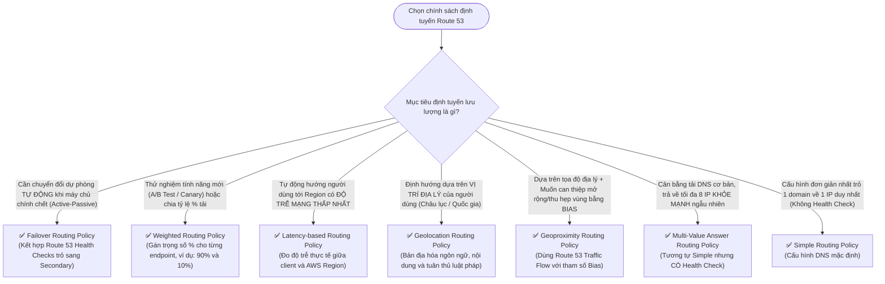

# ⚖️ Decision Matrix: Amazon Route 53 Routing Policies

> Deep Dive chi tiết: [[Route-53-Routing-Policies-and-Failover]] | Trở về: [[00-Domain-2-MOC]]

---

## 1. Sơ đồ cây quyết định trong đề thi (Decision Flowchart)

---

## 2. Bảng tra cứu trực diện 7 Routing Policies

| Routing Policy | Đặc điểm kỹ thuật cốt lõi | Hỗ trợ Health Check? | Kịch bản đề thi kinh điển |
| :--- | :--- | :---: | :--- |
| **Simple** | Trỏ 1 domain tới 1 địa chỉ IP duy nhất (hoặc list IP ngẫu nhiên) | **KHÔNG** | Website đơn giản 1 máy chủ, không yêu cầu chịu lỗi. |
| **Weighted** | Chia tải theo tỷ lệ phần trăm (Trọng số 0 - 255) | **CÓ** | **A/B Testing, Canary deployment** (ví dụ: gửi 5% lưu lượng tới app v2). |
| **Latency-based**| Đo và điều hướng tới Region có **độ trễ mạng thấp nhất** tới client | **CÓ** | Ứng dụng quốc tế đa vùng yêu cầu tốc độ phản hồi nhanh nhất. |
| **Failover** | Mô hình **Active-Passive**: Tự động chuyển sang backup khi primary hỏng | **CÓ (Bắt buộc)** | **Disaster Recovery**, chuyển sang trang bảo trì S3 tĩnh khi sập web. |
| **Geolocation** | Định tuyến dựa trên **Vị trí của User** (Châu lục, quốc gia, bang) | **CÓ** | Bản địa hóa ngôn ngữ, hạn chế quyền phát sóng nội dung, tuân thủ GDPR. |
| **Geoproximity** | Định tuyến theo khoảng cách địa lý + **Độ lệch Bias (-99 đến +99)** | **CÓ** | Dịch chuyển ranh giới phục vụ giữa các data center qua Traffic Flow. |
| **Multi-Value** | Trả về tối đa **8 bản ghi IP khỏe mạnh** ngẫu nhiên | **CÓ** | Cân bằng tải ở cấp độ DNS cơ bản (nhẹ, rẻ hơn ELB). |

---

## 3. Bảng phản xạ nhanh từ khóa đề thi (Keyword Triggers)

| Cụm từ khóa trong đề thi SAA-C03 | Routing Policy được chọn |
| :--- | :--- |
| *"Automatically divert traffic to a standby secondary region when health checks fail"* | **Failover Routing Policy** |
| *"Direct 10% of users to a new software release while 90% use the current version"* | **Weighted Routing Policy** |
| *"Route global users to the AWS Region providing the lowest network latency"* | **Latency-based Routing Policy** |
| *"Ensure European users are routed to EU servers and US users to US servers for legal compliance"*| **Geolocation Routing Policy** |
| *"Adjust the geographic boundary of traffic routed to specific data centers using a bias"* | **Geoproximity Routing Policy** |
| *"Simple DNS-level load balancing returning up to 8 healthy records"* | **Multi-Value Answer Routing Policy** |
| *"Map the root domain (zone apex) to an Application Load Balancer"* | **Route 53 Alias Record (A-Record)** |
