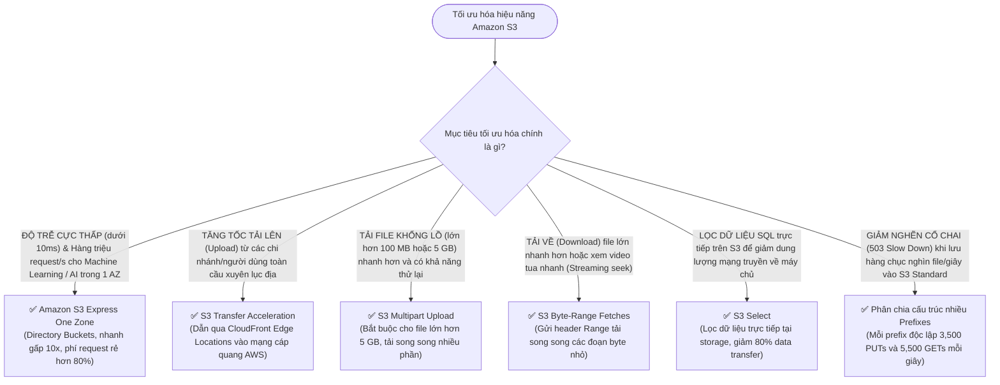

# ⚖️ Decision Matrix: Amazon S3 Performance Options & Tăng Tốc Dữ Liệu

> Deep Dive chi tiết: [[S3-Express-One-Zone-and-Storage-Performance]] | Trở về: [[00-Domain-3-MOC]]

---

## 1. Sơ đồ cây quyết định trong đề thi (Decision Flowchart)

---

## 2. Bảng so sánh các giải pháp tăng tốc S3

| Giải pháp | Cơ chế kỹ thuật | Lợi ích chính | Kịch bản áp dụng chuẩn |
| :--- | :--- | :--- | :--- |
| **S3 Express One Zone** | Lưu trữ trong **Directory Buckets tại 1 AZ** | **Độ trễ < 10ms (10x faster)**, request rẻ hơn 80% | Training AI/ML, High-Frequency Trading, Media Transcoding |
| **S3 Standard (Prefixes)**| Phân tán dữ liệu theo thư mục prefix | Đạt 3,500 PUTs và 5,500 GETs/s **trên mỗi prefix** | Lưu trữ dữ liệu lớn tải cao, Data Lake |
| **S3 Transfer Acceleration**| Định tuyến qua mạng Edge Locations | Tăng tốc upload xuyên quốc gia 50 - 500% | Người dùng/chi nhánh toàn cầu tải file lớn lên S3 |
| **Multipart Upload** | Chia file thành nhiều parts tải song song | Upload nhanh hơn, tự thử lại từng part lỗi | Bắt buộc cho file **> 5 GB**, khuyên dùng cho file **> 100 MB** |
| **Byte-Range Fetches** | Dùng HTTP header `Range: bytes=x-y` | Tải song song nhiều đoạn byte, tải có chọn lọc | Xem video tua nhanh, tải phần đầu của file zip lớn |
| **S3 Select** | Thực thi câu lệnh SQL trực tiếp tại S3 | Giảm tới **80% băng thông truyền tải** | Đọc dữ liệu phân tích từ file CSV/JSON/Parquet lớn |

---

## 3. Bảng phản xạ nhanh từ khóa đề thi (Keyword Triggers)

| Cụm từ khóa trong đề thi SAA-C03 | Giải pháp được chọn |
| :--- | :--- |
| *"Single-digit millisecond latency for frequently accessed data in a single AZ with 80% lower request costs"*| **Amazon S3 Express One Zone** |
| *"Accelerate upload of large files from global users across continents to an S3 bucket"* | **S3 Transfer Acceleration (kết hợp Multipart Upload)** |
| *"Mandatory upload mechanism for objects larger than 5 GB"* | **S3 Multipart Upload** |
| *"Download specific portions of a multi-gigabyte video file to support streaming playback"* | **S3 Byte-Range Fetches** |
| *"Filter large CSV files stored in S3 using SQL without retrieving the full dataset"* | **S3 Select** |
| *"Overcome S3 request rate limits (503 Slow Down) for an analytics ingestion application"* | **Distribute objects across multiple S3 Prefixes** |
