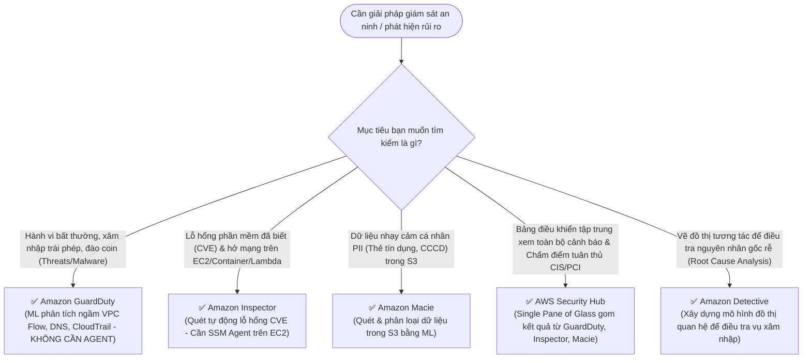

# ⚖️ Decision Matrix: GuardDuty vs Inspector vs Macie vs Security Hub vs Detective

> Deep Dive chi tiết: [[Threat-Detection-and-Auditing]] | Trở về: [[00-Domain-1-MOC]]

---

## 1. Sơ đồ cây quyết định trong đề thi (Decision Flowchart)

---

## 2. Bảng so sánh ma trận 5 dịch vụ an ninh thông minh

| Tiêu chí | Amazon GuardDuty | Amazon Inspector | Amazon Macie | AWS Security Hub | Amazon Detective |
| :--- | :--- | :--- | :--- | :--- | :--- |
| **Phân loại** | **Phát hiện Mối đe dọa (Threat Detection)** | **Quản lý Lỗ hổng (Vulnerability Scanning)** | **Bảo vệ Dữ liệu (Data Privacy / DLP)** | **Quản lý Tư thế An ninh (CSPM & Compliance)** | **Điều tra Sự cố (Incident Investigation)** |
| **Đối tượng phân tích** | - VPC Flow Logs - DNS Query Logs - CloudTrail Events - S3 Data Events - EKS Audit Logs | - EC2 Instances (Hệ điều hành & packages) - ECR Container Images - AWS Lambda Code | Các tệp tin lưu trữ trong **Amazon S3** | Nhận findings từ các dịch vụ AWS khác & Partner | Dữ liệu Graph dựng từ CloudTrail, VPC Flow Logs, GuardDuty |
| **Yêu cầu Agent?** | **KHÔNG** (Agentless hoàn toàn) | **CÓ trên EC2** (SSM Agent); ECR & Lambda không cần | **KHÔNG** | **KHÔNG** | **KHÔNG** |
| **Thời điểm kích hoạt** | Liên tục theo thời gian thực (Real-time) | Định kỳ hoặc khi có image mới push lên ECR | Định kỳ quét (Scheduled) hoặc theo lệnh | Liên tục tổng hợp | Theo yêu cầu điều tra sự cố |
| **Đầu ra chính** | **Threat Findings** (ví dụ: EC2 bị chiếm quyền, gọi ra IP C2) | **CVE Findings** (ví dụ: CVE-2023-38545 cURL vulnerability) | **Data Findings** (ví dụ: phát hiện 10,000 số thẻ tín dụng) | **Compliance Standards** (CIS Benchmark %, PCI-DSS %) | **Graph Visualizations** (Ai đã làm gì, lúc nào, từ đâu) |

---

## 3. Bảng phản xạ nhanh từ khóa đề thi (Keyword Triggers)

| Cụm từ khóa trong đề thi SAA-C03 | Dịch vụ được chọn |
| :--- | :--- |
| *"Detect anomalous API activity or compromised EC2 instances running crypto mining"* | **Amazon GuardDuty** |
| *"Continuous vulnerability assessment for CVEs on EC2 instances and ECR images"* | **Amazon Inspector** |
| *"Identify and classify personally identifiable information (PII) stored in S3"* | **Amazon Macie** |
| *"Centralized dashboard to aggregate findings and track compliance against CIS benchmarks"*| **AWS Security Hub** |
| *"Investigate the root cause of security findings and visualize interaction graphs"* | **Amazon Detective** |
| *"Agentless threat detection analyzing VPC Flow Logs and DNS query logs"* | **Amazon GuardDuty** |
