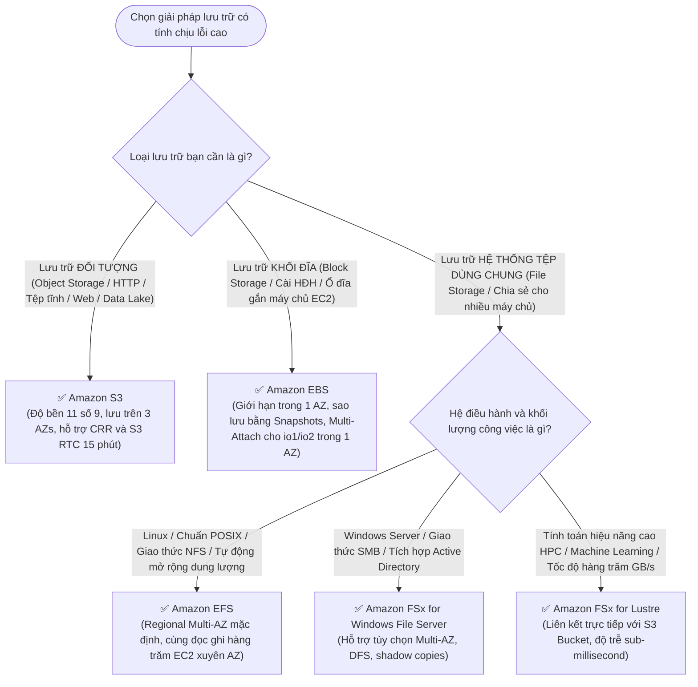

# ⚖️ Decision Matrix: Storage Resilience (EBS vs EFS vs S3 vs FSx)

> Deep Dive chi tiết: [[Storage-Durability-S3-EBS-EFS-FSx]] | Trở về: [[00-Domain-2-MOC]]

---

## 1. Sơ đồ cây quyết định trong đề thi (Decision Flowchart)

---

## 2. Bảng so sánh 5 công nghệ lưu trữ về Tính Sẵn Sàng & Phục Hồi

| Tiêu chí | Amazon EBS | Amazon EFS | Amazon FSx for Windows | Amazon FSx for Lustre | Amazon S3 |
| :--- | :--- | :--- | :--- | :--- | :--- |
| **Mô hình dữ liệu** | **Block Storage** | **File Storage (POSIX)** | **File Storage (SMB)** | **File Storage (POSIX HPC)**| **Object Storage** |
| **Phạm vi khả dụng**| **Khóa chặt trong 1 AZ** | **Toàn Region (Multi-AZ)**| **Single-AZ hoặc Multi-AZ**| Thường là 1 AZ (Scratch/Persist)| **Toàn Region (3+ AZs)** |
| **Độ bền bỉ (Durability)**| 99.8% - 99.999% | **99.999999999% (11 9's)**| Thiết kế cho Enterprise | Theo cấu hình lưu trữ | **99.999999999% (11 9's)** |
| **Chia sẻ nhiều máy chủ**| Chỉ với **Multi-Attach (io1/io2 trong 1 AZ)** | **Hàng ngàn EC2 cùng lúc xuyên AZ** | Hàng ngàn EC2 Windows | Hàng trăm Compute instances | Truy cập qua HTTP/HTTPS API |
| **Cơ chế sao lưu phục hồi**| **EBS Snapshots** (Lưu ngầm trên S3, FSR) | **AWS Backup** tự động | **AWS Backup** / Volume shadow | Đồng bộ ngược lại vào S3 | **Versioning, CRR, S3 RTC** |
| **Tốc độ truy xuất** | IOPS cao, độ trễ sub-ms | Mili-giây | Mili-giây | **Hàng trăm GB/s, sub-ms** | Vài chục mili-giây |

---

## 3. Bảng phản xạ nhanh từ khóa đề thi (Keyword Triggers)

| Cụm từ khóa trong đề thi SAA-C03 | Dịch vụ lưu trữ được chọn |
| :--- | :--- |
| *"Shared file storage accessible concurrently by hundreds of Linux EC2 instances across multiple AZs"*| **Amazon EFS** |
| *"Shared file storage for Windows workloads integrating with Active Directory and SMB protocol"* | **Amazon FSx for Windows File Server (Multi-AZ)** |
| *"High-performance compute (HPC) cluster requiring fast sub-millisecond POSIX file access linked to S3"*| **Amazon FSx for Lustre** |
| *"Attach a high-performance block storage volume to two EC2 instances in the same AZ"* | **Amazon EBS Multi-Attach (`io1` hoặc `io2`)** |
| *"Point-in-time incremental backup of an EBS volume that can be restored instantly without latency penalty"*| **EBS Snapshots kết hợp Fast Snapshot Restore (FSR)** |
| *"Replicate S3 objects to another Region with a guaranteed SLA of 15 minutes"* | **S3 Cross-Region Replication (CRR) với S3 RTC** |
